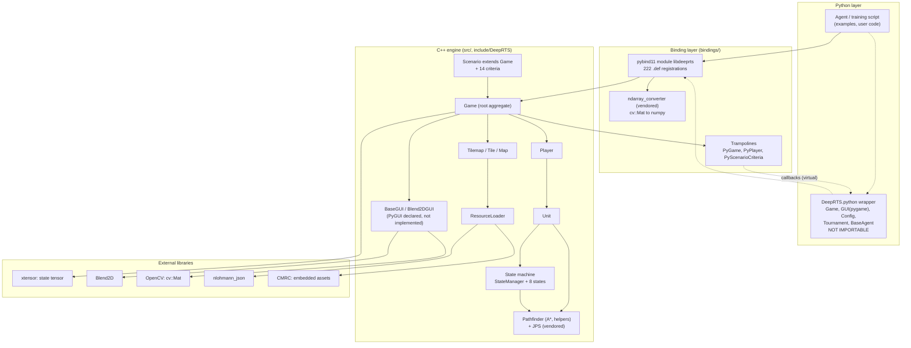
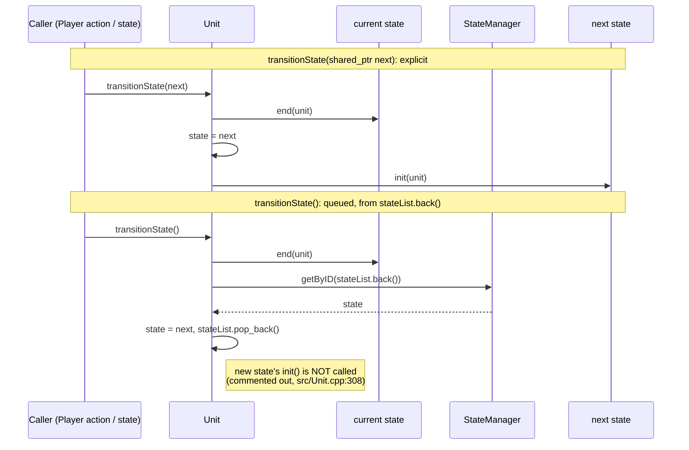
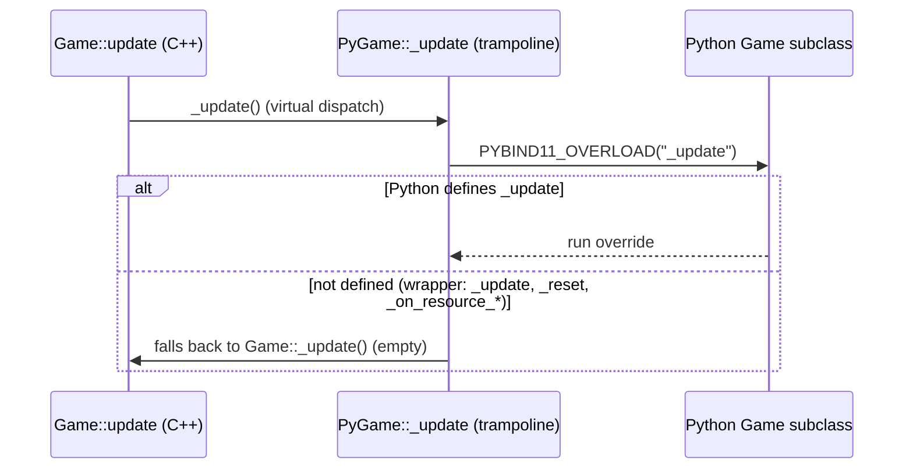
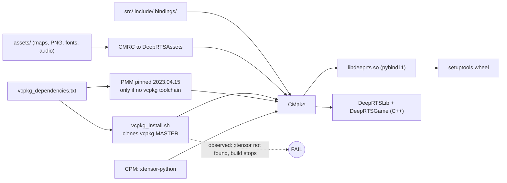

# Architecture Diagrams: deep-rts

**Analysis Date**: 2026-11-14 · **Commit**: `6bfbfd5` · Diagram format: Mermaid. Edges come from `code_graph.sqlite` unless noted.

## Overview

deep-rts is a **single-threaded, in-process simulation library**: a C++ engine (`Game` is the root aggregate) with a pybind11 layer on top, and a Python wrapper above that which, in this checkout, cannot be imported. Rendering is a side channel (Blend2D → `cv::Mat`), not part of the simulation.

## 1. System context and layers



Solid edges: calls present in the graph or source. Dashed: dependencies that exist in code but are non-functional (wrapper) or run through Python at runtime (callbacks). The `Game → trampolines` edge is a **class-hierarchy artefact** (virtual calls on `Game` can land in `PyGame` overrides); `Game` does not include the trampolines.

## 2. Structural coupling (class level)

Function-level call cycles: **0**. Class-level: ten components form **one strongly connected cluster** (Tarjan over class-to-class call counts; trampoline edges excluded as artefacts):

`Game ↔ Player ↔ Unit ↔ State* ↔ Tile ↔ Tilemap ↔ Pathfinder ↔ UnitManager ↔ StateManager ↔ Blend2DGUI`

| Pair | Calls each way | Reading |
|------|---------------|---------|
| `Unit` ↔ `State*` | 54 / 50 | the tightest: states manipulate unit internals, units dispatch to states |
| `Player` ↔ `Unit` | 17 / 13 | |
| `Tile` ↔ `Unit` | 2 / 11 | |
| `Unit` ↔ `UnitManager` | 1 / 6 | factory depends on `Unit`, `Unit` calls factory (`build`) |
| `Game` ↔ `Player` | 2 / 2 | |
| `Game` ↔ `Blend2DGUI` | 3 / 4 | `Game` constructs the GUI; the GUI reads `Game` |

Consequence: there is no seam at which the engine can be split into reusable parts (e.g. headless simulation vs. rendering) without untangling this cluster. `Game` also reaches into `Tile` for the observation tensor: `Tile` writes `tilemap.game.state(...)` directly (`src/Tile.cpp:101,197,216`).

## 3. Class hierarchies

```mermaid
classDiagram
    class Game {
      +update() virtual
      +_update() virtual
      +_render() virtual
      +reset() virtual
      +isTerminal() bool
    }
    class Scenario {
      +update()
      +reset()
      +evaluate()
      +reward()
    }
    class GoldCollectFifteen
    class GeneralAIOneVersusOne
    class LavaMaze
    class PyGame
    <<trampoline>> PyGame
    Game <|-- Scenario
    Scenario <|-- GoldCollectFifteen
    Scenario <|-- GeneralAIOneVersusOne
    Scenario <|-- LavaMaze
    Game <|-- PyGame

    class BaseState {
      +init()
      +update()
      +end()
    }
    class Spawning
    class Idle
    class Walking
    class Harvesting
    class Building
    class Combat
    class Dead
    class Despawned
    BaseState <|-- Spawning
    BaseState <|-- Idle
    BaseState <|-- Walking
    BaseState <|-- Harvesting
    BaseState <|-- Building
    BaseState <|-- Combat
    BaseState <|-- Dead
    BaseState <|-- Despawned

    class ScenarioCriteria {
      +clone()
      +evaluate()
      +reward()
    }
    class PyScenarioCriteria
    <<trampoline>> PyScenarioCriteria
    ScenarioCriteria <|-- PyScenarioCriteria
    ScenarioCriteria <|-- GoldCollect
    ScenarioCriteria <|-- DamageDone
    ScenarioCriteria <|-- UnitsCreated
    ScenarioCriteria <|-- GameEnd

    class Player {
      +evaluatePlayerState() virtual
      +getScore() virtual
    }
    class PyPlayer
    <<trampoline>> PyPlayer
    Player <|-- PyPlayer

    class BaseGUI {
      +render()
      +onTileChange()
    }
    class Blend2DGUI
    class PyGUI
    <<declared only>> PyGUI
    BaseGUI <|-- Blend2DGUI
    BaseGUI <|-- PyGUI
```

(Only 4 of the 14 criteria are drawn; all derive `ScenarioCriteria`: `class_hierarchy` table.) A `Scenario` **is a** `Game` (inheritance, not composition): every scenario carries the full engine and overrides `update()`/`reset()`.

The 8 state objects are **flyweights**: `StateManager` creates one instance of each (`src/state/StateManager.cpp:12-19`) and all units share them; per-unit data lives in `Unit`, and the `Unit` is passed into `init/update/end`. `Walking` holds a `JPS::Searcher` member, hence one shared searcher for all units (safe only because the engine is single-threaded).

## 4. Sequence: one RL step (native Python API)

```mermaid
sequenceDiagram
    participant A as Agent (Python)
    participant P as Player
    participant G as Game
    participant U as Unit
    participant S as BaseState (virtual)
    participant T as Tile
    A->>P: do_action(a)  [1..16]
    P->>U: targeted unit: move / attack / harvest / build
    U->>U: transitionState(next)
    U->>S: end() then init() on new state
    A->>G: update()
    G->>G: tick(): now = clock
    alt running and not terminal and now >= update_next
      loop every unit not removed
        G->>U: update()
        U->>S: update(unit)  (CHA: 9 possible targets)
        U->>T: tile.update(unit): terrain damage (lava)
      end
      Note over U,G: Observation channels 1-9 are written only by<br/>Unit.setPosition (move/spawn/build), not every step
      G->>G: _update() (virtual; may call into Python)
      G->>G: ticks += 1
    else wall-clock gate not reached
      G-->>A: returns without stepping
    end
    A->>G: is_terminal()
    G->>P: evaluatePlayerState() per player
    A->>G: read state (W,H,10)
```

Evidence: `src/Game.cpp:109-131`, `src/Unit.cpp` (`Unit::update` → `state->update(*this)`; `tile->update`, which only applies terrain damage, `src/Tile.cpp` `Tile::update`), `src/Player.cpp:400+`. Observation writers: `Tile` (channel 0) and `Unit::setPosition` → `setStateForTile` (channels 1-9), whose callers are `Walking::update`, `Spawning::update`, `Building::update` and `Unit::build`. The `alt` branch is the wall-clock gate described in [02](02-interface-specification.md): with `max_fps = 60` (the default) most `update()` calls in a fast loop do **not** step.

## 5. Sequence: state transition (explicit vs queued)



## 6. Sequence: Python callback through a trampoline



Graph evidence: 7 `cpp→python` edges exist (only for hooks the wrapper defines); 4 hooks (`_update`, `_reset`, `_on_resource_gather`, `_on_resource_depleted`) have no Python implementation ([09](09-code-graph.md), boundary section).

## 7. Build and packaging flow (as designed vs. as observed)



## Component Inventory

| Component | Files | Responsibility | Functions in graph |
|-----------|-------|----------------|--------------------|
| Game | `Game.h/.cpp` | root aggregate: clock, units, players, tensor, episode lifecycle | 39 |
| Player | `Player.h/.cpp` | resources, action dispatch (`do_action`, cc 22), unit ownership | 40 |
| Unit | `unit/Unit.h`, `Unit.cpp` | entity, state transitions, building, combat | 42 |
| UnitManager | `UnitManager.*` | factory: 6 unit types (Peasant, TownHall, Barracks, Footman, Farm, Archer) and their `buildInventory`; `Peon` and `None` fall back to Peasant | 8 |
| Tile / Tilemap / Map | `Tile.*`, `Tilemap.*`, `Map.*` | terrain, resources, neighbours, map load | 25 / 8 / 1 |
| State machine | `state/*` | behaviour per state; `Harvesting::update` has fan-out 30 | 8 states + manager |
| Pathfinder | `util/Pathfinder.*`, `JPS.h` | A\*, nearest-walkable/harvestable search, JPS walking paths | 8 |
| Scenarios | `scenario/*` | reward/termination layer | 9 + 3 scenarios + 14 criteria |
| GUI | `gui/*` | Blend2D rendering | 4 + sprite/tileset helpers |
| Bindings | `bindings/*` | pybind11 surface and trampolines | 18 free + 16 trampolines |

## Documentation Comparison

| Source | Matches reality? |
|--------|------------------|
| Legacy `architecture.md` diagram "Pygame as a rendering backend peer of Blend2D" | partly: pygame GUI exists in `gui.py` but sits in the non-importable wrapper |
| Legacy "Python Wrapper → ML Frameworks" layering | the wrapper layer is the broken part; ML frameworks attach to the native `Engine` directly in the only working examples (`example_01/02`) |
