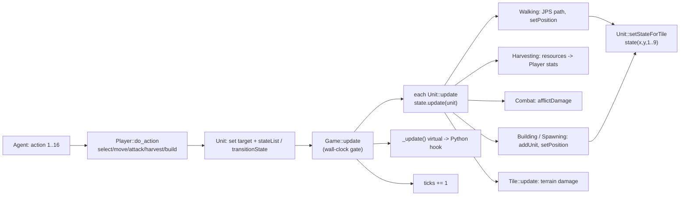
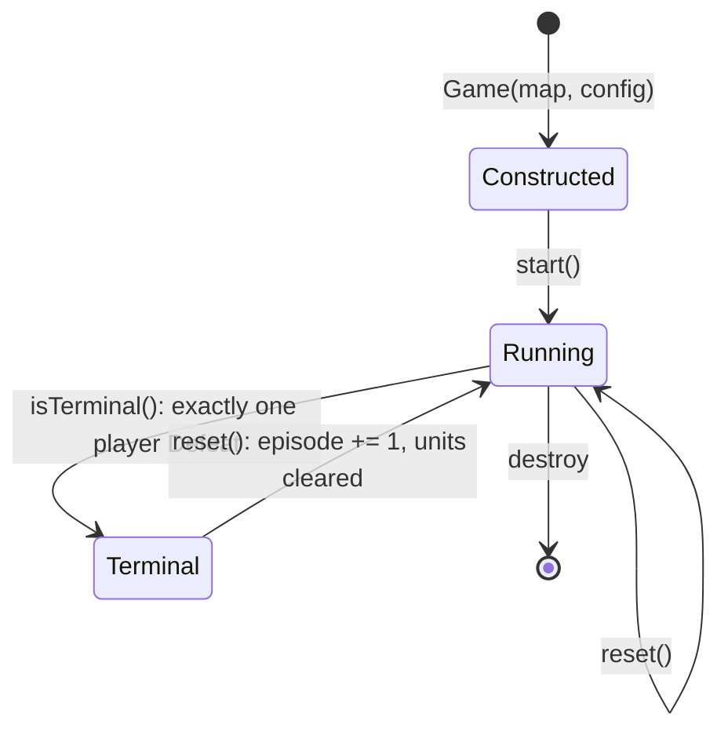
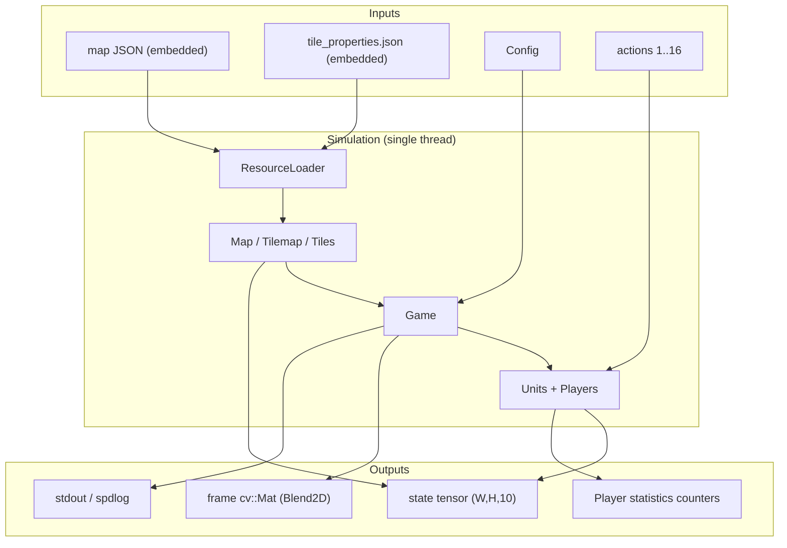

# Data Flow Map: deep-rts

**Analysis Date**: 2026-11-14 · **Commit**: `6bfbfd5` · Sources: `src/`, `bindings/`, graph queries. Items marked *(not executed)* are by code reading.

## Executive Summary

| Aspect | Value |
|--------|-------|
| Input sources | 4: map JSON (embedded), tile-property JSON (embedded), `Config`, agent actions (+ Python callbacks) |
| Storage | **none persistent**; everything lives in one `Game` object; assets are compiled into the binary |
| Outputs | observation tensor `(W,H,10)`, rendered frames (`cv::Mat`), per-player statistics counters, stdout text |
| Concurrency | none: a single-threaded loop; the engine is not thread-safe |
| PII / sensitive data | none |

## Data Input Sources

| Source | Entry point | Format | Validation |
|--------|-------------|--------|------------|
| Map file | `Game(map_file[, Config])` → `Map` → `ResourceLoader::loadMapJSON` (`ResourceLoader.cpp:47-85`) | Tiled JSON (`layers[0].data`, `width`, `height`, tile sizes) | JSON parse errors → `std::runtime_error`; missing tile-property keys only print to stdout (`Map.cpp:38-43`) and then continue |
| Tile properties | `ResourceLoader::loadMAPJson` (`ResourceLoader.cpp:~100-140`) | `tile_types` + `tile_metadata` | `nlohmann::json::exception` → `runtime_error` |
| Configuration | `Config` setters / `Config::defaults()` | in-memory struct; 17 properties | **no range checks** except yield modifiers (`Config.h:13-23`); `setTickModifier(0)` is accepted |
| Agent action | `Player::do_action(int)` | integer 1-16 | range-checked → `RuntimeError` (`Player.cpp:403`); silently ignored if the player has no units (`:408`) |
| Manual input | `do_manual_action`, `left_click`, `Unit::right_click` | tile coordinates | tile bounds checks inside `Tilemap` |
| Python callbacks | trampolines (`PYBIND11_OVERLOAD`) | Python return values | pybind11 casts; `getScore` truncated to int (DISC-015) |

Asset lookup order: embedded CMRC archive first; on any exception, filesystem path derived from the working directory (`ResourceLoader.cpp:47-85`). The Python wrapper's `os.chdir(dir_path)` (`game.py:29`) exists only for that fallback.

## Data Transformations

### Transformation pipeline (one simulation tick)

### Transformation details

| Step | Function | Input → Output | Business rule |
|------|----------|----------------|---------------|
| Wall-clock gate | `Game::update` (`Game.cpp:109-131`) | clock → tick or no-op | `now >= _update_next`; `_update_next += 1s/max_fps`; default `max_fps=60` |
| Unit step | `Unit::update` | state object → unit mutation | state is a shared flyweight; unit passed in |
| Path planning | `Walking::update` (`Walking.cpp:102-111`) | goal tile → JPS path | vendored JPS, `NoStartCheck|NoEndCheck` flags |
| Resource gather | `Harvesting::update` (fan-out 30) | tile → `Player::sGathered*`, unit carry | yield modifiers from `Config`; `harvestForever` option |
| Damage | `Combat::update`, `Tile::update` | attacker/terrain → `afflictDamage` | tile damage = `ceil(tileModifier × config.tileDamageModifier)` |
| Observation write | `Unit::setStateForTile` (`Unit.cpp:595-607`) | unit → tensor cells | **only** on `setPosition` (DISC-013) |
| Scenario reward | `Scenario::reward` (`Scenario.cpp:44`) | criteria → 0/1 | boolean AND (DISC-012) |

## Data Storage

| System | What | Lifetime |
|--------|------|----------|
| `Game` object (heap/stack, one per process in practice) | all game state | until destroyed; `reset()` re-initialises in place |
| CMRC archive in the binary | maps, textures, fonts, audio | immutable |
| Python process | tensor view, frames | caller-owned |

No files are written by the engine. The Python `Tournament` module (`tournament.py`, 627 lines) holds Elo/bracket state in memory only (not importable anyway).

### Entity storage map

| Entity | Stored in | Created by | Destroyed by |
|--------|-----------|-----------|---------------|
| Unit | `Game::units` (`std::vector<Unit>`, `reserve(8000)`) | `Player::addUnit` (`Player.cpp:261`) | **never erased**; flagged `removedFromGame`; vector cleared on `Game::reset` |
| Unit name → pointer | `Game::unitsNameMap` | `addUnit` (`Player.cpp:264`) | erased lazily in `Game::update` for removed units |
| Player | `Game::players` (`std::vector<Player>`, `reserve(8)`) | `addPlayer` / `insertPlayer` (copy) | `reset()` resets in place; never removed |
| Tile | `Tilemap::tiles` | map load | rebuilt by `tilemap.reset()` |
| Observation | `Game::state` | constructor (`fill(-1)`), `Tile`, `Unit` | refilled only partially on reset |
| Scenario criteria | `Scenario::criteriaList` (8 sets, cloned per player) | constructor, and again on every `reset()` | replaced |

### Pointer stability (data lifecycle risk)

`Player::addUnit` does `units.push_back(...)` and stores `&units.back()` in `unitsNameMap` (`Player.cpp:261-264`); tiles also hold occupant pointers (`Tile::setOccupant(this)`). This is safe only while `units.size() ≤ 8000` (the `reserve`): beyond that the vector reallocates and **every stored pointer dangles**. `MAX_UNITS = 1000` per player is never enforced (grep: used only for `reserve` and a Python constant). Dead units are flagged, not erased, so long episodes with unit churn consume the budget: *(not executed)*.

## Data Lifecycle: Episode

`reset()` (`Game.cpp:79-107`): resets tilemap, clears `units` and `unitsNameMap`, resets players, `ticks = 0`, `episode += 1`, `terminal = false`, then `_reset()` and `_onEpisodeStart()`. It does **not** reset the clock (`_update_next`) or `selectedPlayer`, and does not refill `state` to `-1` (relies on `Tile::reset` and `Unit::clearStateForTile`).

## Data Lifecycle: Unit

`Spawning → Idle → {Walking | Harvesting | Building | Combat} → Idle … → Dead → Despawned`, tracked by `Unit::state` (shared flyweight) and `stateList` (LIFO queue of upcoming state ids). The queued `transitionState()` does not call the new state's `init()` (`Unit.cpp:308`).

## Data Flow Diagram (system)

## Data Entity Matrix

| Entity | Create | Read | Update | Delete |
|--------|--------|------|--------|--------|
| Unit | `Player::addUnit`, `UnitManager::constructUnit` | `Game::update`, bindings (40 readonly fields) | states, `Unit::*` | flagged only |
| Player | `Game::addPlayer/insertPlayer` | `Game::isTerminal`, scenarios, bindings | `do_action`, resource ops | none |
| Tile | `Tilemap` | pathfinding, GUI, bindings | `Tile::setDepleted/setOccupant` | rebuilt on reset |
| Tensor | `Game` ctor | agent | `Tile` (ch 0), `Unit::setStateForTile` (ch 1-9) | refilled on reset (partial) |
| Frame | `Blend2DGUI::render` | agent/cv2 | per render | per render |
