# Code Graph Analysis

**Project**: deep-rts (old engine, pinned `6bfbfd5` + `patches/deep-rts/`)  
**Generated**: 2026-11-14  
**Tool**: tree-sitter-cpp 0.23.4 + tree-sitter-python 0.25.0 (tier 2) with class-hierarchy analysis; pyan3 2.9.0 as tier-1 cross-check (Python)  
**Backend**: sqlite (`code/deep-rts/code_graph.sqlite`, gitignored; regenerate: `venv/bin/python scripts/cg-extract.py && venv/bin/python scripts/cg-reports.py`)

---

## Extraction Summary

| Metric | Value |
|--------|-------|
| Functions / Methods | 502 (C++ 387, Python 115) |
| Call Edges | 732 (624 call, 108 instantiates; 120 via virtual dispatch) |
| Entry Points | 166 |
| Dead Code Candidates | 100 (19.9%) |
| Cycles Detected | 0 |
| Extraction Method | static (tree-sitter, tier 2) |
| Storage Backend | sqlite |
| Source files analysed | 113 C++ (.cpp/.h/.hpp) + 28 Python |
| Cross-language edges | cpp→python: 7, python→cpp: 39 |

> **Coverage Confidence**: **Medium-High for C++ project-internal calls, Medium for Python.** Static syntax-aware extraction (not AI inference), but no type checker: see the scorecard and gaps below. Virtual calls are resolved by class-hierarchy analysis (every override of the static receiver type's method), so `is_dynamic=1` edges are an over-approximation: the real target is one of the listed overrides.

> **Scope decisions** (answers to the skill's interactive dialogue, chosen for this run): Targeted single repo `deep-rts`; unified SQLite graph; all outputs; tests excluded (`DeepRTS/python/tests/`); vendored code excluded (see gaps).

---

## Tooling (workflow 0.1)

| Language | Tool | Tier | Why not tier 1 |
|---|---|---|---|
| C++ | `tree-sitter-cpp` + custom class-hierarchy / typed-variable / pybind resolution (`scripts/cg-extract.py`) | 2 | No type-aware tool usable: clang/clangd absent; the project does not configure (xtensor/vcpkg failure, see CONTEXT.md), so no `compile_commands.json` |
| Python | `tree-sitter-python` + self/typed-variable/import/pybind resolution | 2 | pyan3 2.9.0 **was run first** (tier 1). It cannot see the pybind boundary and was imprecise here (details below), so it is kept as a cross-check, not merged |

### pyan3 cross-check (Python, `DeepRTS/python` + examples)

| | Count |
|---|---|
| pyan3 edges that map to a known node | 68 (+117 to external/unmapped targets) |
| tree-sitter Python→Python edges | 47 |
| Agree | 32 (47.1% of pyan3, 68.1% of tree-sitter) |
| pyan3-only | 36, of which 6 are self-loops (cause not investigated; `Game.__init__ → Game.__init__` is one, consistent with `super(Game, self).__init__` being resolved to the subclass itself) |
| tree-sitter-only | 15 (sampled: `Game → GUI`/`AbstractGUI` calls, `Game.__init__ → Config.__init__`; query `pyan_crosscheck` for all) |

Verdict: pyan3's pyan-only edges include ones that are wrong on inspection (e.g. `Game.update`, `Game.view`, `Game.capture`, `Game.set_player` and `Game._render` are each reported as calling `Game.__init__`; none of them do), so treating pyan3 as ground truth would lower precision. All disagreements are in the `pyan_crosscheck` table.

---

## Coverage Scorecard

Any metric below 100% must have a named reason in `stats.gaps`; they are listed under the table.

| Metric | Value | Gap Reason (if < 100%) |
|--------|-------|-------------------------|
| Repo Coverage | 1/1 (100%) | learning-rts untracked (no remote yet), excluded by definition |
| Language Coverage | 2/4 (50%) | CMake and Bash build/install scripts not extracted (deliberate; grammars exist) |
| Cross-Repo Mechanism Coverage | n/a (0/0) | single repo; Python↔C++ pybind boundary resolved in call edges instead |
| Edge Resolution Coverage (blended, strict) | 35.6% | external-package calls are in the denominator; project-internal only: 81.2% |

### Edge Resolution Coverage — by language

| Language | Resolved | Unresolved | external-package | Coverage (strict) | Coverage (project-internal) |
|---|---|---|---|---|---|
| C++ | 642 | 771 | 754 | 45.4% | 97.4% |
| Python | 90 | 553 | 400 | 14.0% | 37.0% |

### Unresolved Calls — by reason

| Reason | Count | Meaning |
|--------|-------|---------|
| `external-package` | 1154 | stdlib / OpenCV / Blend2D / xtensor / pybind11 / nlohmann / torch / pygame, via namespace allowlist: expected, not a gap |
| `missing-repo` | 0 | none: single repo |
| `dynamic` | 0 | callable variables / virtual methods without any concrete definition in scope |
| `type-alias` | 170 | genuinely unresolved after the 2.1.1 heuristics: the bucket to investigate |

**Gaps (named):**

- learning-rts is not tracked yet (no remote; see sources/urls.md), so repoCoverage covers only the one tracked repo
- languageCoverage 2/4: CMake and Bash (build/install scripts, 6 files) are deliberately not extracted; tree-sitter-cmake/bash exist but those files are build tooling, not product call graph
- crossRepoMechanismCoverage n/a: single repo; the only cross-boundary mechanism (pybind11 Python<->C++) is resolved into call edges, not mechanism_edges
- no type-aware tool for C++ (clang absent; project does not configure: xtensor/vcpkg failure). tree-sitter + class-hierarchy analysis only: templates, overloads beyond arity and calls through auto-typed expression chains are not resolved
- edgeResolutionCoverage is strict (all unresolved calls in the denominator). Excluding external-package calls (std/OpenCV/Blend2D/xtensor/pybind/torch/pygame): cpp 97.4%, python 37.0%
- python: 153 calls stay type-alias after all 2.1.1 heuristics (untyped parameters in the examples and pygame-facing gui code); pyan3 tier-1 cross-check agrees with only 47.1% of its own edges (see 09-code-graph.md)
- SRE view 08 does not exist (arch-analysis does not produce it): reports/sre-hot-paths.md skipped
- vendored code excluded from the graph: include/DeepRTS/util/JPS.h (1538 lines), bindings/utilities/ndarray_converter.* ; calls into them are external-package

### Top `type-alias` targets (the actionable bucket)

| Target | Language | Count |
|---|---|---|
| `util.config` | python | 20 |
| `?.attr` | cpp | 4 |
| `?.key` | cpp | 3 |
| `targeted_unit.build` | python | 3 |
| `Engine.Config` | python | 2 |
| `ScenarioCriteria.begin` | cpp | 2 |
| `ScenarioCriteria.end` | cpp | 2 |
| `action_values.cpu` | python | 2 |
| `action_values.max` | python | 2 |
| `action_values.max(1)[0].unsqueeze` | python | 2 |

---

## Complexity Hotspots

11 functions have cyclomatic complexity > 10 (top 10 shown; McCabe: 1 + branches + `&&`/`||`).

| Function | Location | Complexity | Action |
|----------|----------|------------|--------|
| `Player::do_action` | `src/Player.cpp:400` | 22 | Review / refactor |
| `Unit::setDirection#L400` | `src/Unit.cpp:400` | 19 | Review / refactor |
| `ColorConverter::hsv` | `include/DeepRTS/util/ColorConverter.hpp:15` | 14 | Review / refactor |
| `Unit::build#L127` | `src/Unit.cpp:127` | 14 | Review / refactor |
| `Harvesting::update` | `src/state/Harvesting.cpp:11` | 14 | Review / refactor |
| `AbstractGUI.event` | `DeepRTS/python/gui.py:127` | 14 | Review / refactor |
| `Map::Map` | `src/Map.cpp:13` | 13 | Review / refactor |
| `Tilemap::neighbors` | `src/Tilemap.cpp:89` | 13 | Review / refactor |
| `AbstractGUI.draw_unit` | `DeepRTS/python/gui.py:172` | 11 | Review / refactor |
| `ReplayBuffer.sample` | `examples/example_05/torch/conv_agent.py:76` | 11 | Review / refactor |

---

## High Fan-in Functions

Most-called functions. Changes here have the highest blast radius. (Max fan-in in this codebase is small, so no row reaches the template's High (>20) tier.)

| Function | Location | Callers | Risk |
|----------|----------|---------|------|
| `Unit::transitionState#L313` | `src/Unit.cpp:313` | 14 | Medium |
| `ScenarioCriteria::ScenarioCriteria` | `src/scenario/criteria/ScenarioCriteria.cpp:7` | 14 | Medium |
| `Unit::transitionState` | `src/Unit.cpp:288` | 11 | Medium |
| `Player::getGame` | `src/Player.cpp:492` | 10 | Low |
| `Tilemap::getTile` | `src/Tilemap.cpp:159` | 10 | Low |
| `Tile::getOccupant` | `src/Tile.cpp:118` | 9 | Low |
| `Blend2DUnitState::load` | `include/DeepRTS/gui/Blend2DGUI.h:88` | 8 | Low |
| `Blend2DUnitState::get` | `include/DeepRTS/gui/Blend2DGUI.h:99` | 8 | Low |
| `BaseState::BaseState` | `include/DeepRTS/state/BaseState.h:25` | 8 | Low |
| `Game::addPlayer` | `src/Game.cpp:191` | 8 | Low |

---

## High Fan-out Functions

Coordination hubs. Note: virtual calls fan out to every override, which inflates `fan_out` for the state-machine drivers.

| Function | Location | Callees | Note |
|----------|----------|---------|------|
| `Harvesting::update` | `src/state/Harvesting.cpp:11` | 30 | High coordination |
| `Unit::transitionState` | `src/Unit.cpp:288` | 28 | High coordination |
| `Unit::transitionState#L313` | `src/Unit.cpp:313` | 18 | High coordination |
| `<module>` | `examples/example_01/basic_01.py:1` | 18 | High coordination |
| `Config::defaults` | `include/DeepRTS/Config.h:149` | 17 | High coordination |
| `Player::do_action` | `src/Player.cpp:400` | 17 | High coordination |
| `Unit::build#L127` | `src/Unit.cpp:127` | 17 | High coordination |
| `main` | `src/main.cpp:14` | 16 | High coordination |
| `Scenario::createCriterionsForPlayers` | `src/scenario/Scenario.cpp:22` | 15 |  |
| `GeneralAIOneVersusOne::GeneralAIOneVersusOne` | `src/scenario/scenarios/GeneralAIOneVersusOne.cpp:13` | 15 |  |

---

## Circular Dependencies

No cycles detected (Tarjan SCC over the whole graph, not only entry-reachable; independently re-checked with a bounded recursive CTE: 0 nodes on any cycle). Caveat: callbacks that re-enter through `std::function`/Python (`PyGame::_update` → Python → `Game.*`) are only partly modelled, and `transitionState` re-entry via virtual `init()/end()` would show here if those bodies called back.

---

## Dead Code Summary

100 functions have no callers and are not entry points (19.9%). C++: 64, Python: 36. Destructors are never counted (implicitly invoked).

| Category | Count |
|---|---|
| Total dead code candidates | 100 |
| File last modified > 1 year ago | 100 |
| File last modified 6 months - 1 year | 0 |
| File last modified < 6 months | 0 |
| Unknown | 0 |

> `last_modified` is the last commit touching the **file**, not the function. See `reports/dead-code.md`.

---

## Python ↔ C++ Boundary (pybind11)

The engine is a C++ library exposed to Python through pybind11 (`bindings/`). The graph models both directions:

- **Python → C++**: 39 edges, resolved through the `pybind_bindings` table (222 `.def*` registrations; 110 C++ nodes are entry points because Python can call them).
- **C++ → Python** (virtual-method trampolines): 7 edges from `bindings/trampolines/*` overrides to the Python methods that implement them; 16 callback sites.

**Callbacks C++ expects from Python but Python does not define.** The trampolines use `PYBIND11_OVERLOAD` (not `_PURE`), so when no Python override exists pybind11 calls the C++ base implementation: no error, but the Python-side hook never fires:

| Trampoline | Python name expected | Defined in Python? |
|---|---|---|
| `PyGame::_render` | `_render` | yes |
| `PyGame::_caption` | `_caption` | yes |
| `PyGame::_update` | `_update` | **no** |
| `PyGame::_reset` | `_reset` | **no** |
| `PyGame::_onUnitCreate` | `_on_unit_create` | yes |
| `PyGame::_onUnitDestroy` | `_on_unit_destroy` | yes |
| `PyGame::_onTileChange` | `_on_tile_change` | yes |
| `PyGame::_onEpisodeStart` | `_on_episode_start` | yes |
| `PyGame::_onEpisodeEnd` | `_on_episode_end` | yes |
| `PyGame::_onResourceGather` | `_on_resource_gather` | **no** |
| `PyGame::_onResourceDepleted` | `_on_resource_depleted` | **no** |

**Python names the wrapper calls on `self` that neither Python nor the C++ bindings define** (candidate `AttributeError`s at runtime):

| Call site | Target |
|---|---|
| (none) | every direct `self.<name>()` call in `game.py` resolves to a Python method or a pybind binding |

---

## Entry Point Call Graphs

Top 3 entry points by reachable-node count. Diagrams show the first two hops only (full chains: `view_entry_traces`).

### main (cli): reaches 274 functions

```mermaid
graph TD
  nsrc_main_cpp_main["main"]
  ninclude_DeepRTS_Config_h_Config__defaults["Config::defaults"]
  nsrc_main_cpp_main --> ninclude_DeepRTS_Config_h_Config__defaults
  ninclude_DeepRTS_Config_h_Config__setTickModifier["Config::setTickModifier"]
  ninclude_DeepRTS_Config_h_Config__defaults --> ninclude_DeepRTS_Config_h_Config__setTickModifier
  ninclude_DeepRTS_Config_h_Config__setInstantTownHall["Config::setInstantTownHall"]
  ninclude_DeepRTS_Config_h_Config__defaults --> ninclude_DeepRTS_Config_h_Config__setInstantTownHall
  ninclude_DeepRTS_Config_h_Config__setInstantBuilding["Config::setInstantBuilding"]
  ninclude_DeepRTS_Config_h_Config__defaults --> ninclude_DeepRTS_Config_h_Config__setInstantBuilding
  ninclude_DeepRTS_Config_h_Config__setHarvestForever["Config::setHarvestForever"]
  ninclude_DeepRTS_Config_h_Config__defaults --> ninclude_DeepRTS_Config_h_Config__setHarvestForever
  ninclude_DeepRTS_Config_h_Config__setConsoleCaptionEnabled["Config::setConsoleCaptionEnabled"]
  nsrc_main_cpp_main --> ninclude_DeepRTS_Config_h_Config__setConsoleCaptionEnabled
  ninclude_DeepRTS_Config_h_Config__setGUI["Config::setGUI"]
  nsrc_main_cpp_main --> ninclude_DeepRTS_Config_h_Config__setGUI
  nsrc_scenario_scenarios_LavaMaze_cpp_LavaMaze__LavaMaze["LavaMaze::LavaMaze"]
  nsrc_main_cpp_main --> nsrc_scenario_scenarios_LavaMaze_cpp_LavaMaze__LavaMaze
  nsrc_scenario_Scenario_cpp_Scenario__Scenario["Scenario::Scenario"]
  nsrc_scenario_scenarios_LavaMaze_cpp_LavaMaze__LavaMaze --> nsrc_scenario_Scenario_cpp_Scenario__Scenario
  nsrc_scenario_scenarios_LavaMaze_cpp_LavaMaze__getConfig["LavaMaze::getConfig"]
  nsrc_scenario_scenarios_LavaMaze_cpp_LavaMaze__LavaMaze --> nsrc_scenario_scenarios_LavaMaze_cpp_LavaMaze__getConfig
  nsrc_scenario_criteria_ResourceIncrement_cpp_ResourceIncrement__ResourceIncrement["ResourceIncrement::ResourceIncrement"]
  nsrc_scenario_scenarios_LavaMaze_cpp_LavaMaze__LavaMaze --> nsrc_scenario_criteria_ResourceIncrement_cpp_ResourceIncrement__ResourceIncrement
  nsrc_Game_cpp_Game__addPlayer["Game::addPlayer"]
  nsrc_scenario_scenarios_LavaMaze_cpp_LavaMaze__LavaMaze --> nsrc_Game_cpp_Game__addPlayer
  nsrc_main_cpp_main --> nsrc_Game_cpp_Game__addPlayer
  nsrc_Game_cpp_Game__setSelectedPlayer["Game::setSelectedPlayer"]
  nsrc_Game_cpp_Game__addPlayer --> nsrc_Game_cpp_Game__setSelectedPlayer
  nsrc_Game_cpp_Game__setMaxFPS["Game::setMaxFPS"]
  nsrc_main_cpp_main --> nsrc_Game_cpp_Game__setMaxFPS
  nsrc_Game_cpp_Game__start["Game::start"]
  nsrc_main_cpp_main --> nsrc_Game_cpp_Game__start
  nsrc_Game_cpp_Game__timerInit["Game::timerInit"]
  nsrc_Game_cpp_Game__start --> nsrc_Game_cpp_Game__timerInit
  nsrc_Game_cpp_Game__getUnitByNameID["Game::getUnitByNameID"]
  nsrc_main_cpp_main --> nsrc_Game_cpp_Game__getUnitByNameID
  nsrc_Game_cpp_Game__isTerminal["Game::isTerminal"]
  nsrc_main_cpp_main --> nsrc_Game_cpp_Game__isTerminal
  nsrc_Player_cpp_Player__evaluatePlayerState["Player::evaluatePlayerState"]
  nsrc_Game_cpp_Game__isTerminal -.-> nsrc_Player_cpp_Player__evaluatePlayerState
  nbindings_trampolines_PyPlayer_h_PyPlayer__evaluatePlayerState["PyPlayer::evaluatePlayerState"]
  nsrc_Game_cpp_Game__isTerminal -.-> nbindings_trampolines_PyPlayer_h_PyPlayer__evaluatePlayerState
  nsrc_Game_cpp_Game___onEpisodeEnd["Game::_onEpisodeEnd"]
  nsrc_Game_cpp_Game__isTerminal -.-> nsrc_Game_cpp_Game___onEpisodeEnd
  nbindings_trampolines_PyGame_h_PyGame___onEpisodeEnd["PyGame::_onEpisodeEnd"]
  nsrc_Game_cpp_Game__isTerminal -.-> nbindings_trampolines_PyGame_h_PyGame___onEpisodeEnd
  nsrc_Player_cpp_Player__do_action["Player::do_action"]
  nsrc_main_cpp_main --> nsrc_Player_cpp_Player__do_action
  nsrc_Player_cpp_Player__nextUnit["Player::nextUnit"]
  nsrc_Player_cpp_Player__do_action --> nsrc_Player_cpp_Player__nextUnit
  nsrc_Player_cpp_Player__previousUnit["Player::previousUnit"]
  nsrc_Player_cpp_Player__do_action --> nsrc_Player_cpp_Player__previousUnit
  nsrc_Player_cpp_Player__getTargetedUnit["Player::getTargetedUnit"]
  nsrc_Player_cpp_Player__do_action --> nsrc_Player_cpp_Player__getTargetedUnit
  nsrc_Unit_cpp_Unit__tryMove["Unit::tryMove"]
  nsrc_Player_cpp_Player__do_action --> nsrc_Unit_cpp_Unit__tryMove
  nsrc_scenario_Scenario_cpp_Scenario__update["Scenario::update"]
  nsrc_main_cpp_main -.-> nsrc_scenario_Scenario_cpp_Scenario__update
  nsrc_Game_cpp_Game__update["Game::update"]
  nsrc_scenario_Scenario_cpp_Scenario__update --> nsrc_Game_cpp_Game__update
  nsrc_scenario_Scenario_cpp_Scenario__evaluate["Scenario::evaluate"]
  nsrc_scenario_Scenario_cpp_Scenario__update --> nsrc_scenario_Scenario_cpp_Scenario__evaluate
  nsrc_scenario_Scenario_cpp_Scenario__update -.-> nsrc_Player_cpp_Player__evaluatePlayerState
  nsrc_scenario_Scenario_cpp_Scenario__update -.-> nbindings_trampolines_PyPlayer_h_PyPlayer__evaluatePlayerState
  nsrc_Game_cpp_Game__render["Game::render"]
  nsrc_main_cpp_main --> nsrc_Game_cpp_Game__render
  nsrc_Game_cpp_Game___render["Game::_render"]
  nsrc_Game_cpp_Game__render -.-> nsrc_Game_cpp_Game___render
  nbindings_trampolines_PyGame_h_PyGame___render["PyGame::_render"]
  nsrc_Game_cpp_Game__render -.-> nbindings_trampolines_PyGame_h_PyGame___render
```

**External-touching functions on the path**: 67 (e.g. `main`, `Scenario::Scenario`, `Game::Game#L26`, `Map::Map`)  
**Data stores touched**: None (no DB; persistence is files via `ResourceLoader`)

### module (script): reaches 237 functions

```mermaid
graph TD
  nexamples_example_01_basic_01_py__module_["module"]
  ninclude_DeepRTS_Config_h_Config__defaults["Config::defaults"]
  nexamples_example_01_basic_01_py__module_ --> ninclude_DeepRTS_Config_h_Config__defaults
  ninclude_DeepRTS_Config_h_Config__setTickModifier["Config::setTickModifier"]
  ninclude_DeepRTS_Config_h_Config__defaults --> ninclude_DeepRTS_Config_h_Config__setTickModifier
  ninclude_DeepRTS_Config_h_Config__setInstantTownHall["Config::setInstantTownHall"]
  ninclude_DeepRTS_Config_h_Config__defaults --> ninclude_DeepRTS_Config_h_Config__setInstantTownHall
  ninclude_DeepRTS_Config_h_Config__setInstantBuilding["Config::setInstantBuilding"]
  ninclude_DeepRTS_Config_h_Config__defaults --> ninclude_DeepRTS_Config_h_Config__setInstantBuilding
  ninclude_DeepRTS_Config_h_Config__setHarvestForever["Config::setHarvestForever"]
  ninclude_DeepRTS_Config_h_Config__defaults --> ninclude_DeepRTS_Config_h_Config__setHarvestForever
  ninclude_DeepRTS_Config_h_Config__setConsoleCaptionEnabled["Config::setConsoleCaptionEnabled"]
  nexamples_example_01_basic_01_py__module_ --> ninclude_DeepRTS_Config_h_Config__setConsoleCaptionEnabled
  ninclude_DeepRTS_Config_h_Config__setGUI["Config::setGUI"]
  nexamples_example_01_basic_01_py__module_ --> ninclude_DeepRTS_Config_h_Config__setGUI
  nsrc_Game_cpp_Game__Game["Game::Game"]
  nexamples_example_01_basic_01_py__module_ --> nsrc_Game_cpp_Game__Game
  nsrc_Game_cpp_Game__Game --> ninclude_DeepRTS_Config_h_Config__defaults
  nsrc_Map_cpp_Map__Map["Map::Map"]
  nsrc_Game_cpp_Game__Game --> nsrc_Map_cpp_Map__Map
  nsrc_Tilemap_cpp_Tilemap__Tilemap["Tilemap::Tilemap"]
  nsrc_Game_cpp_Game__Game --> nsrc_Tilemap_cpp_Tilemap__Tilemap
  nsrc_state_StateManager_cpp_StateManager__StateManager["StateManager::StateManager"]
  nsrc_Game_cpp_Game__Game --> nsrc_state_StateManager_cpp_StateManager__StateManager
  nsrc_Game_cpp_Game__Game_L26["Game::Game#L26"]
  nexamples_example_01_basic_01_py__module_ --> nsrc_Game_cpp_Game__Game_L26
  nsrc_Game_cpp_Game__Game_L26 --> nsrc_Map_cpp_Map__Map
  nsrc_Game_cpp_Game__Game_L26 --> nsrc_Tilemap_cpp_Tilemap__Tilemap
  nsrc_Game_cpp_Game__Game_L26 --> nsrc_state_StateManager_cpp_StateManager__StateManager
  nsrc_Game_cpp_Game___internalInit["Game::_internalInit"]
  nsrc_Game_cpp_Game__Game_L26 --> nsrc_Game_cpp_Game___internalInit
  nsrc_Game_cpp_Game__addPlayer["Game::addPlayer"]
  nexamples_example_01_basic_01_py__module_ --> nsrc_Game_cpp_Game__addPlayer
  nsrc_Game_cpp_Game__setSelectedPlayer["Game::setSelectedPlayer"]
  nsrc_Game_cpp_Game__addPlayer --> nsrc_Game_cpp_Game__setSelectedPlayer
  nsrc_Game_cpp_Game__setMaxFPS["Game::setMaxFPS"]
  nexamples_example_01_basic_01_py__module_ --> nsrc_Game_cpp_Game__setMaxFPS
  nsrc_Game_cpp_Game__start["Game::start"]
  nexamples_example_01_basic_01_py__module_ --> nsrc_Game_cpp_Game__start
  nsrc_Game_cpp_Game__timerInit["Game::timerInit"]
  nsrc_Game_cpp_Game__start --> nsrc_Game_cpp_Game__timerInit
  nsrc_Game_cpp_Game__reset["Game::reset"]
  nexamples_example_01_basic_01_py__module_ --> nsrc_Game_cpp_Game__reset
  nsrc_Tilemap_cpp_Tilemap__reset["Tilemap::reset"]
  nsrc_Game_cpp_Game__reset --> nsrc_Tilemap_cpp_Tilemap__reset
  nsrc_Player_cpp_Player__reset["Player::reset"]
  nsrc_Game_cpp_Game__reset --> nsrc_Player_cpp_Player__reset
  nsrc_Game_cpp_Game___reset["Game::_reset"]
  nsrc_Game_cpp_Game__reset -.-> nsrc_Game_cpp_Game___reset
  nbindings_trampolines_PyGame_h_PyGame___reset["PyGame::_reset"]
  nsrc_Game_cpp_Game__reset -.-> nbindings_trampolines_PyGame_h_PyGame___reset
  nsrc_Game_cpp_Game__isTerminal["Game::isTerminal"]
  nexamples_example_01_basic_01_py__module_ --> nsrc_Game_cpp_Game__isTerminal
  nsrc_Player_cpp_Player__evaluatePlayerState["Player::evaluatePlayerState"]
  nsrc_Game_cpp_Game__isTerminal -.-> nsrc_Player_cpp_Player__evaluatePlayerState
  nbindings_trampolines_PyPlayer_h_PyPlayer__evaluatePlayerState["PyPlayer::evaluatePlayerState"]
  nsrc_Game_cpp_Game__isTerminal -.-> nbindings_trampolines_PyPlayer_h_PyPlayer__evaluatePlayerState
  nsrc_Game_cpp_Game___onEpisodeEnd["Game::_onEpisodeEnd"]
  nsrc_Game_cpp_Game__isTerminal -.-> nsrc_Game_cpp_Game___onEpisodeEnd
  nbindings_trampolines_PyGame_h_PyGame___onEpisodeEnd["PyGame::_onEpisodeEnd"]
  nsrc_Game_cpp_Game__isTerminal -.-> nbindings_trampolines_PyGame_h_PyGame___onEpisodeEnd
  nsrc_Player_cpp_Player__do_action["Player::do_action"]
  nexamples_example_01_basic_01_py__module_ --> nsrc_Player_cpp_Player__do_action
  nsrc_Player_cpp_Player__nextUnit["Player::nextUnit"]
  nsrc_Player_cpp_Player__do_action --> nsrc_Player_cpp_Player__nextUnit
  nsrc_Player_cpp_Player__previousUnit["Player::previousUnit"]
  nsrc_Player_cpp_Player__do_action --> nsrc_Player_cpp_Player__previousUnit
  nsrc_Player_cpp_Player__getTargetedUnit["Player::getTargetedUnit"]
  nsrc_Player_cpp_Player__do_action --> nsrc_Player_cpp_Player__getTargetedUnit
  nsrc_Unit_cpp_Unit__tryMove["Unit::tryMove"]
  nsrc_Player_cpp_Player__do_action --> nsrc_Unit_cpp_Unit__tryMove
  nbindings_Random_cpp_Random_get_lambda_["Random.getlambda"]
  nexamples_example_01_basic_01_py__module_ --> nbindings_Random_cpp_Random_get_lambda_
```

**External-touching functions on the path**: 51 (e.g. `Game::Game`, `Map::Map`, `ResourceLoader::loadMapJSON`, `GetCurrentWorkingDir`)  
**Data stores touched**: None (no DB; persistence is files via `ResourceLoader`)

### Scenario::computeOptimalStrategy (python-binding): reaches 204 functions

```mermaid
graph TD
  nsrc_scenario_Scenario_cpp_Scenario__computeOptimalStrategy["Scenario::computeOptimalStrategy"]
  nsrc_scenario_Scenario_cpp_Scenario__optimalStrategy["Scenario::optimalStrategy"]
  nsrc_scenario_Scenario_cpp_Scenario__computeOptimalStrategy -.-> nsrc_scenario_Scenario_cpp_Scenario__optimalStrategy
  nsrc_scenario_scenarios_GoldCollectFifteen_cpp_GoldCollectFifteen__optimalStrategy["GoldCollectFifteen::optimalStrategy"]
  nsrc_scenario_Scenario_cpp_Scenario__computeOptimalStrategy -.-> nsrc_scenario_scenarios_GoldCollectFifteen_cpp_GoldCollectFifteen__optimalStrategy
  nsrc_scenario_scenarios_LavaMaze_cpp_LavaMaze__optimalStrategy["LavaMaze::optimalStrategy"]
  nsrc_scenario_Scenario_cpp_Scenario__computeOptimalStrategy -.-> nsrc_scenario_scenarios_LavaMaze_cpp_LavaMaze__optimalStrategy
  nsrc_scenario_scenarios_LavaMaze_cpp_LavaMaze__optimalStrategy --> nsrc_scenario_Scenario_cpp_Scenario__optimalStrategy
  nsrc_Game_cpp_Game__setSelectedPlayer["Game::setSelectedPlayer"]
  nsrc_scenario_Scenario_cpp_Scenario__computeOptimalStrategy --> nsrc_Game_cpp_Game__setSelectedPlayer
  nsrc_Game_cpp_Game__getUnitByNameID["Game::getUnitByNameID"]
  nsrc_scenario_Scenario_cpp_Scenario__computeOptimalStrategy --> nsrc_Game_cpp_Game__getUnitByNameID
  nsrc_scenario_Scenario_cpp_Scenario__optimalPlayGameStep["Scenario::optimalPlayGameStep"]
  nsrc_scenario_Scenario_cpp_Scenario__computeOptimalStrategy --> nsrc_scenario_Scenario_cpp_Scenario__optimalPlayGameStep
  nsrc_scenario_Scenario_cpp_Scenario__update["Scenario::update"]
  nsrc_scenario_Scenario_cpp_Scenario__optimalPlayGameStep -.-> nsrc_scenario_Scenario_cpp_Scenario__update
  nsrc_scenario_Scenario_cpp_Scenario__evaluate["Scenario::evaluate"]
  nsrc_scenario_Scenario_cpp_Scenario__optimalPlayGameStep --> nsrc_scenario_Scenario_cpp_Scenario__evaluate
  nsrc_scenario_Scenario_cpp_Scenario__reward["Scenario::reward"]
  nsrc_scenario_Scenario_cpp_Scenario__optimalPlayGameStep --> nsrc_scenario_Scenario_cpp_Scenario__reward
  nsrc_Player_cpp_Player__setTargetedUnitID["Player::setTargetedUnitID"]
  nsrc_scenario_Scenario_cpp_Scenario__computeOptimalStrategy --> nsrc_Player_cpp_Player__setTargetedUnitID
  nsrc_Player_cpp_Player__do_action["Player::do_action"]
  nsrc_scenario_Scenario_cpp_Scenario__computeOptimalStrategy --> nsrc_Player_cpp_Player__do_action
  nsrc_Player_cpp_Player__nextUnit["Player::nextUnit"]
  nsrc_Player_cpp_Player__do_action --> nsrc_Player_cpp_Player__nextUnit
  nsrc_Player_cpp_Player__previousUnit["Player::previousUnit"]
  nsrc_Player_cpp_Player__do_action --> nsrc_Player_cpp_Player__previousUnit
  nsrc_Player_cpp_Player__getTargetedUnit["Player::getTargetedUnit"]
  nsrc_Player_cpp_Player__do_action --> nsrc_Player_cpp_Player__getTargetedUnit
  nsrc_Unit_cpp_Unit__tryMove["Unit::tryMove"]
  nsrc_Player_cpp_Player__do_action --> nsrc_Unit_cpp_Unit__tryMove
  nsrc_scenario_Scenario_cpp_Scenario__reset["Scenario::reset"]
  nsrc_scenario_Scenario_cpp_Scenario__computeOptimalStrategy -.-> nsrc_scenario_Scenario_cpp_Scenario__reset
  nsrc_Game_cpp_Game__reset["Game::reset"]
  nsrc_scenario_Scenario_cpp_Scenario__reset --> nsrc_Game_cpp_Game__reset
  nsrc_scenario_Scenario_cpp_Scenario__createCriterionsForPlayers["Scenario::createCriterionsForPlayers"]
  nsrc_scenario_Scenario_cpp_Scenario__reset --> nsrc_scenario_Scenario_cpp_Scenario__createCriterionsForPlayers
```

**External-touching functions on the path**: 52 (e.g. `Scenario::computeOptimalStrategy`, `Game::tick`, `Unit::getBuildEntity`, `Pathfinder::find_first_walkable_tile`)  
**Data stores touched**: None (no DB; persistence is files via `ResourceLoader`)

> Dashed arrows are virtual-dispatch edges (class-hierarchy over-approximation). See `reports/entry-point-map.md`.

