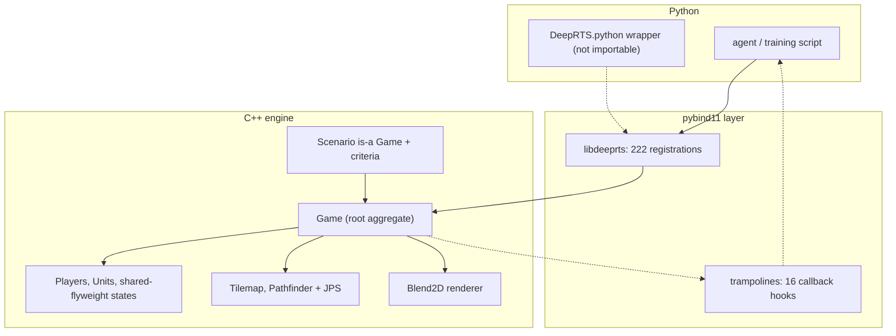

# Architecture Documentation

**Project**: deep-rts (the **old** engine; `learning-rts` is the new project and is not analysed here)
**Repository**: https://github.com/pa-research/deep-rts (renamed from `cair/DeepRTS`), pinned `6bfbfd5` + `patches/deep-rts/0001`
**Analysis Date**: 2026-11-14
**Analyzed By**: AI agent, quantum-toolbox v3.3.1 `arch-analysis` + `code-graph` skills
**Codebase Version**: `6bfbfd5` (upstream HEAD, 2023-05-16, dormant since)

---

## Executive Summary

deep-rts is a C++17 real-time-strategy **simulation library** for reinforcement-learning research (IEEE CIG 2018): about 9,000 own lines of engine code plus a pybind11 layer exposing 222 members of 28 classes to Python, and a small Python wrapper. One `Game` object owns everything: clock, map, units, players, a `(W,H,10)` observation tensor and an optional Blend2D renderer. There is no database, network, thread or persistence; assets are compiled into the binary.

The design is conventional (state-pattern units with shared flyweight states, scenarios that **are** games, trampolines for Python callbacks) but tightly coupled: ten core classes form a single strongly connected cluster. **In its current state the project does not build** (configure fails at xtensor; the pip path uses unpinned vcpkg master), **the Python wrapper cannot be imported**, and verification of the documentation shows it is accurate about structure and wrong about usage (50% claim accuracy). Reading the engine against its own RL contract found six silent defects: boolean scenario rewards, stale observation channels, an episode-end hook that fires every step, a wall-clock step gate that defaults to 60 steps/s, sliced Python players, and a copy-spawn bug.

The code graph (502 functions, 732 edges, SQLite) resolves 97% of project-internal C++ calls and models the Python↔C++ boundary in both directions. It is the queryable basis for the fix-vs-rebuild discussion.

### Quick Stats

| Metric | Value |
|--------|-------|
| Primary Language | C++17 (8,974 own lines, 113 files) |
| Secondary | Python (2,654 lines incl. examples) |
| Binding framework | pybind11 (222 registrations, 28 classes, 16 callback trampolines) |
| Functions / call edges | 502 / 732 (120 virtual-dispatch edges) |
| Total Dependencies | 7 C++ vcpkg ports (+ xsimd transitively) + 5 declared Python packages (+ 15 entries in `examples/requirements.txt`, 1 duplicate) |
| API Endpoints | 0 (library; see interface spec) |
| External Integrations | 0 |
| Builds | **No** |

### Health Overview

| Area | Status | Notes |
|------|--------|-------|
| Dependencies | 🔴 | unreproducible build; 3.5-year-old pinned baseline vs unpinned master; xtensor mismatch with our patch |
| Documentation | 🔴 | 50% accurate; install and Python usage wrong |
| Error Handling | 🔴 | no strategy; several UB paths; asserts vanish in Release |
| Security | 🟡 | leaked webhook token (public repo); no network surface |
| Architecture | 🟡 | clean ideas, class-level monolith, no function-level cycles |
| Testing | 🔴 | 1 test, cannot pass |

---

## Analysis Results

| # | Document | Status | Description |
|---|----------|--------|-------------|
| 1 | [Technology Manifest](analysis/01-technology-manifest.md) | ✅ | Languages, frameworks, dependencies, build tools |
| 2 | [Interface Specification](analysis/02-interface-specification.md) | ✅ | Python API, RL contract (actions/observation/reward), callbacks, formats |
| 3 | [Architecture Diagrams](analysis/03-architecture-diagrams.md) | ✅ | Layers, class hierarchies, 4 sequence diagrams, coupling |
| 4 | [Documentation Audit](analysis/04-documentation-audit.md) | ⚠️ | 34-claim ledger, 21 discrepancies |
| 5 | [Dependency Health](analysis/05-dependency-health.md) | ⚠️ | versions, currency, secrets, risk |
| 6 | [Data Flow Map](analysis/06-data-flow-map.md) | ✅ | inputs, transformations, storage, lifecycle |
| 7 | [Error Handling](analysis/07-error-handling.md) | ⚠️ | mechanisms and 11 gaps |
| 9 | [Code Graph](analysis/09-code-graph.md) | ✅ | View 09: SQLite call graph, scorecard with named gaps |

Reports: [Findings Summary](reports/findings-summary.md) · [Entry Point Map](reports/entry-point-map.md) · [Dead Code](reports/dead-code.md) · [SQLite Cookbook](reports/sqlite-cookbook.md). *Not generated:* `sre-hot-paths.md` (requires SRE view 08, which `arch-analysis` does not produce).

**Status Legend**: ⏳ Pending | ✅ Complete | ⚠️ Issues Found

---

## Key Findings

### Critical Issues

1. **The project does not build.** CMake configure fails at `find_package(xtensor)`; `setup.py` runs a script that clones vcpkg master, installs unpinned, and needs root. → [05](analysis/05-dependency-health.md)
2. **The Python wrapper cannot be imported** (`ImportError` at `gui.py:3`; 4 undefined names). Only the native `DeepRTS.Engine` can work, and 2 of 5 numbered examples use it. → [04](analysis/04-documentation-audit.md) DISC-001
3. **A Discord webhook token is committed** in `.travis.yml:28` (since 2017). Revoke it. → [05](analysis/05-dependency-health.md)

### Recommendations

| Priority | Recommendation | Effort | Impact |
|----------|----------------|--------|--------|
| High | Revoke the webhook | S | removes a live credential |
| High | Decide fix-vs-rebuild before spending effort on either (inputs in [findings summary](reports/findings-summary.md)) | S | avoids polishing the wrong thing |
| High | If kept: one pinned dependency path (manifest mode, xtensor ≥ 0.26), no root | M | the build is the gate for everything else |
| High | If kept: fix the six RL-contract defects | M | rewards, observations, episode ends are currently unreliable |
| Medium | Correct the docs (action IDs, tensor channels, install) | S | stops new users hitting errors |
| Medium | Resolve the class-level cluster before extending the engine | L | the only way to get seams |

---

## Architecture Overview

---

## Navigation

### By Topic

- **Tech stack?** → [Technology Manifest](analysis/01-technology-manifest.md)
- **How do I drive it from Python / what does the agent see?** → [Interface Specification](analysis/02-interface-specification.md)
- **Visual overview, class hierarchies, sequences** → [Architecture Diagrams](analysis/03-architecture-diagrams.md)
- **Can I trust the old docs?** → [Documentation Audit](analysis/04-documentation-audit.md)
- **Why won't it build / dependency risk?** → [Dependency Health](analysis/05-dependency-health.md)
- **Where does the data live?** → [Data Flow Map](analysis/06-data-flow-map.md)
- **What happens on errors?** → [Error Handling](analysis/07-error-handling.md)
- **Query the code yourself** → [SQLite Cookbook](reports/sqlite-cookbook.md), database at `code/deep-rts/code_graph.sqlite` (regenerate with the commands in the manifest)

### Related Documentation

- Original (unverified) docs: [`docs/legacy/deep-rts/`](../legacy/deep-rts/), kept as the baseline this analysis was audited against.
- Project agent instructions: [AGENTS.md](../../AGENTS.md), state: [CONTEXT.md](../../CONTEXT.md)

---

## Analysis Metadata

| Field | Value |
|-------|-------|
| Analysis Tool | AI agent: arch-analysis + code-graph skills (quantum-toolbox v3.3.1) |
| Files Analyzed | 113 C++ + 28 Python parsed; build/CI/config files read; 10 maps and tile properties inspected |
| Commit | `6bfbfd5` (+ `patches/deep-rts/0001-local-build-fixes-2026-01.patch`) |
| Branch | upstream `main` |
| Executed during analysis | stubbed import of `DeepRTS.python`; AST import-resolution check; pyflakes; pyan3; SQL and graph traversals. **The engine itself was never built or run.** |
| Interactive-dialogue choices | docs dir `docs/`; Mermaid; code-graph scope: single repo, unified SQLite, all outputs |

---

*Generated by arch-analysis skill. Corrections to the previous hand-written analysis are listed in [04](analysis/04-documentation-audit.md).*
