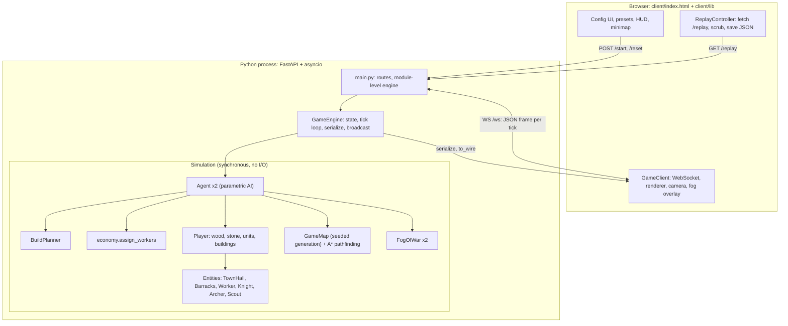
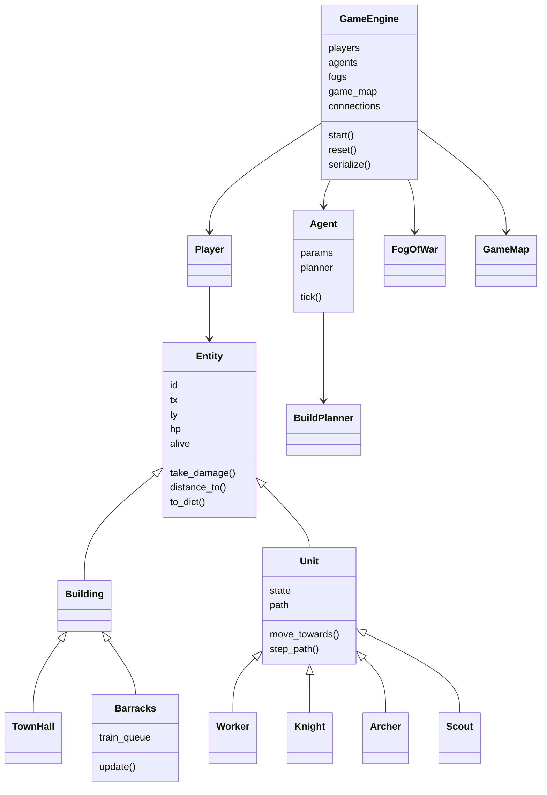
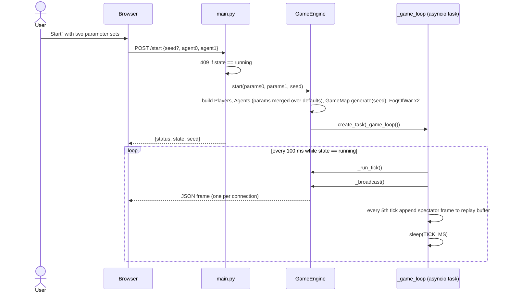
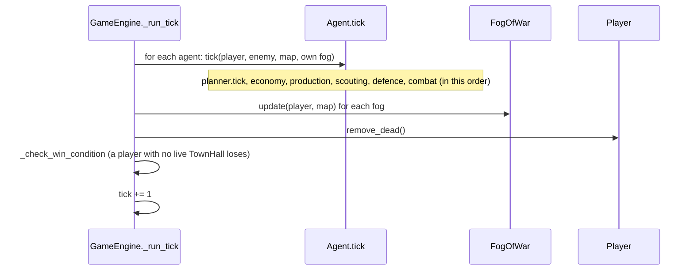
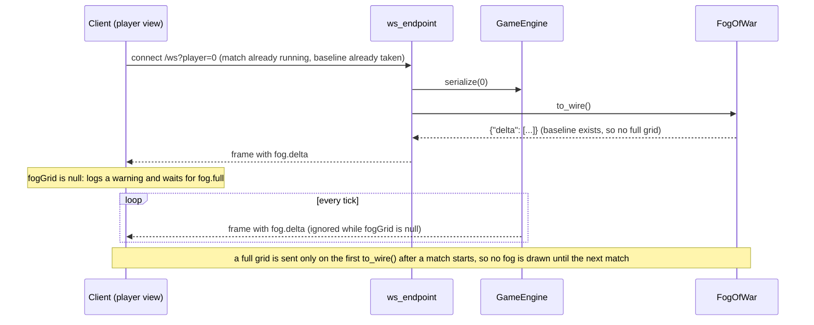
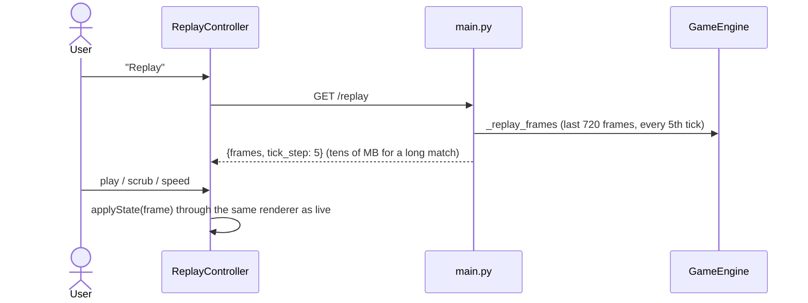

# Architecture Diagrams: ejaj-boj

**Analysis date**: 2026-11-15 · **Commit**: `fde9d3c` · Mermaid. Structure from the code graph and source reading; claims marked *ran* were executed.

## 1. System overview

A single Python process holds one game; browsers watch it through a WebSocket and control it through three HTTP calls.

**Shape (graph, read).** Three layers: transport (`main.py`), orchestration (`GameEngine`), and a synchronous simulation (agents, entities, map, fog) that contains no `await` and no I/O. That separation is why 456 tests run in 3 seconds and why the whole match can be driven by `_run_tick()` without a server (*ran*: about 2,700 ticks/s on one core including both agents).

## 2. Code structure (class hierarchy)

Entity ids come from a process-global counter. Inheritance is shallow (2 levels). Behaviour lives in **`Agent`** (835 lines, the biggest file): entities mostly hold data and movement; **combat, production and scouting rules are inside the agent** (`Knight.try_attack` exists but is unused; the agent applies damage itself, see [dead-code](../reports/dead-code.md)). There are **no function-level cycles** (*graph*).

## 3. Sequence: starting and running a match

## 4. Sequence: one simulation tick

Order is fixed (`GameEngine._run_tick`). Agent 0 acts before agent 1 and both mutate the shared world immediately, so player 0 has a first-mover edge within each tick (default-vs-default came out 10/10 over 20 seeds, *ran*, too few to detect a small bias).

## 5. Sequence: a player-view client connects mid-match (the fog-baseline problem)

*Server side ran; client side read.* Two tabs on the same player, or a refresh (the client reconnects every 2 s after a close), trigger it.

## 6. Sequence: replay

The replay reuses the live renderer, which is a good design. Its limits: frames carry no seed, parameters or version, so a replay cannot be re-run or attributed; `POST /reset` or a new `/start` deletes it; only the last 3,600 ticks survive.

## 7. Component inventory

| Component | File | Lines | Responsibility |
|-----------|------|-------|----------------|
| Transport | `server/main.py` | 162 | routes, module-level engine, static mounts |
| Orchestrator | `server/core/game_engine.py` | 332 | lifecycle, tick order, serialization, broadcast |
| AI | `server/ai/agent.py`, `build_planner.py`, `economy.py` | 835, 234, 253 | parametric policy |
| World | `server/core/entities.py`, `player.py`, `fog.py`, `pathfinding.py`, `constants.py`; `server/maps/game_map.py` | 284, 38, 126, 75, 124; 257 | state and rules |
| Client | `client/index.html` + `client/lib/*.mjs` | 1,894 + 1,203 | renderer, UI, networking |

## 8. What the docs say vs the code

`AGENTS.md`'s architecture tree places the game loop in `server/game_engine.py` and fog in `server/fog_of_war.py`. In the code the engine is `server/core/game_engine.py` (the top-level file is an unused shim) and fog is `server/core/fog.py`. Details in [04](04-documentation-audit.md).
