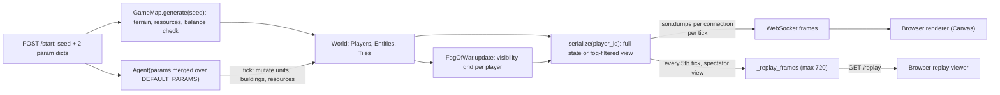
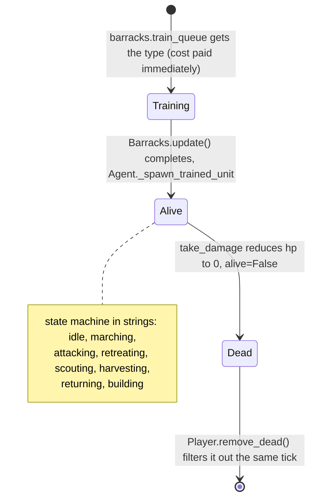

# Data Flow Map: ejaj-boj

**Analysis date**: 2026-11-15 · **Commit**: `fde9d3c` · *ran* = executed; *read* = source reading; *graph* = code graph.

## Executive summary

All data lives **in memory in one Python process**, for the duration of one match. Nothing is persisted: no database, no files written, no browser storage (`git grep` for `localStorage`, `sessionStorage`, `indexedDB` in `client/` finds nothing). A process restart, `POST /reset` or a new `POST /start` discards the match **and its replay**. The one feedback loop is the simulation tick (agents read world state and mutate it); the one fan-out is the per-tick broadcast to every WebSocket client, and 97% of its bytes are the map, which does not change except for resource counts.

## Data input sources

| Source | Data | Validation |
|--------|------|------------|
| `POST /start` body | `seed`, `agent0`, `agent1` parameter dicts | type is "dict"; **no key or value validation** |
| `GET /ws?player=` | which view to receive | anything except `0`/`1` means spectator |
| Constants | `server/core/constants.py` (map size, costs, speeds, `DEFAULT_PARAMS`) | none needed |
| Random seed | request, or `random.randint` | `random.seed(seed)` is the first statement of map generation |
| Client UI | parameter sliders, presets, speed multiplier (client-only) | HTML ranges only |

## Transformations

| Step | Where | Notes |
|------|-------|-------|
| Map generation | `GameMap.generate` | seed → clusters of forest (wood) and quarry (stone), two lakes, spawn zones cleared; up to 10 retries until each map half holds resources within 30% of the other; after 10 failures it **keeps the last (unbalanced) map and logs a warning**. Over 300 seeds, 298 were balanced and 2 fell back (*ran*) |
| Agent decision | `Agent.tick` | reads the whole world through `player`, `enemy_player`, `map`, `fog`; mutates them directly (there is no command layer) |
| Serialization | `GameEngine.serialize` | rebuilds dicts for every entity and the full tile map on every call; called once per connection per tick plus once per 5th tick for the replay |
| Wire | `json.dumps` of the whole frame | no compression, no delta except for fog |

## Data storage

| Entity | Where it lives | Lifetime |
|--------|----------------|----------|
| Match state: `players`, `agents`, `game_map`, `fogs`, `winner`, `_tick` | `GameEngine` attributes | cleared by `reset()`, replaced by `start()` |
| Entity ids | module-global counter `entities._next_id` | **never reset**: ids keep growing across matches in one process |
| Replay frames | `GameEngine._replay_frames` | last 720 frames (every 5th tick); cleared on `reset()`/`start()` |
| Connections | `GameEngine.connections` (dict: ws, player_id, spectator, `fog_initialized`) | until disconnect or a failed send; `fog_initialized` is written but never read |
| Client state | JavaScript objects (`gameState`, `fogGrid`, camera, replay frames) | page lifetime; `fogGrid` reset on reconnect |

## Entity lifecycle: a unit

Units are plain objects in `player.units` lists; there is no entity manager, no pooling and no id lookup table (agents search the lists). Dynamic attributes are attached ad hoc (`_build_target`, `_build_ticks`, `_patrol_x`, `_patrol_y` on units; `hasattr`/`getattr` guards read them back), so a unit's real shape is not visible in its class.

## Data quality observations

| # | Observation | Evidence |
|---|-------------|----------|
| Q1 | **Determinism holds only if the id counter is reset.** Same seed, same params: identical state hashes at every sampled tick when ids are reset between runs; **different** when a second match runs in the same process (ids continue from the previous match) | *ran*, experiments A1/A2. Game logic itself is deterministic: it uses the global `random` seeded once at map generation |
| Q2 | Agent randomness uses the **global** `random` module (`random.random`, `random.sample`), shared with the web layer (`random.randint` for default seeds) | `agent.py:211,466`, `main.py:110` |
| Q3 | The map is serialized and sent **every tick** although only `tile.resource` ever changes (97% of a 57 KB frame) | *ran*, [02](02-interface-specification.md) |
| Q4 | Replay frames duplicate the map too, up to 720 × 57 KB ≈ 41 MB of JSON-equivalent per match | computed from the measured frame size |
| Q5 | Win condition checks players in order: if both town halls die in the same tick, **player 1 is declared the winner** | *ran*, experiment D |
| Q6 | A full-state snapshot (deepcopy of players, map, fogs, agents) costs about 8.3 ms at tick 300, about 22× a tick, so copy-based lookahead search would be slow | *ran*, experiment g |

## Cross-reference: who reads and writes what

| Data | Written by | Read by |
|------|------------|---------|
| `player.wood/stone` | economy (deposit), production (costs), worker spawn | planner, production, serialization |
| `tile.resource` | economy (harvest) | economy (find nearest), serialization, client minimap/tiles |
| unit `state`, `path` | agent, economy | agent, serialization |
| `fog.grid` | `FogOfWar.update` | agent (visibility filter), serialization, `to_wire` |
| `last_hit_tick` | `take_damage` | `_manage_defense` (reaction window) |
