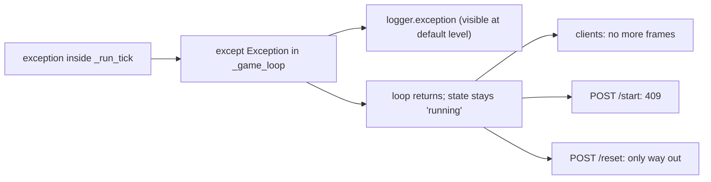

# Error Handling: ejaj-boj

**Analysis date**: 2026-11-15 · **Commit**: `fde9d3c` · *ran* = executed; *read* = source reading.

## Executive summary

Error handling is **minimal and local**: three HTTP error responses, a try/except around the game loop and around each WebSocket, and a warning in map generation. It is adequate while every input is well-formed and every client behaves. It has **one serious failure mode**: any exception inside a tick ends the game loop silently while the engine still reports `running`, which also blocks `POST /start` with 409 until someone calls `POST /reset`. That is reachable from the public API with a single bad parameter value (*ran*).

| Mechanism | Count / where |
|-----------|---------------|
| `HTTPException` | 2: 409 "Match already running" (`main.py:108`), 404 "no replay available" (`main.py:125`) |
| `try/except` in the server | game loop (`game_engine.py:262-274`), `_broadcast` per connection (`:296-304`), `ws_endpoint` (`main.py:146-162`) |
| `assert` / custom exceptions | none |
| Logging | `logging.getLogger(__name__)` in 4 modules; calls: `logger.exception` ×1 (game loop), `logger.debug` ×2 (WebSocket errors), `logger.warning` ×2 (map fallback, shim) |
| Client | `try/catch` around `JSON.parse` + `applyState` that only `console.error`s; `onerror` closes the socket; `onclose` reconnects after 2 s |

## Error sources and reactions

| Source | Trigger | Reaction |
|--------|---------|----------|
| Match already running | `POST /start` | 409 with a clear message |
| No replay | `GET /replay` before any frames | 404 |
| Malformed body | not JSON / wrong shape | FastAPI/Pydantic 422 (framework default) |
| **Bad parameter value** | e.g. `"worker_ratio": "high"` | `/start` returns success; the first tick raises `TypeError` in the agent; the loop logs `logger.exception` and **exits** |
| Unknown parameter key | any | accepted silently, ignored |
| Client disconnect | WS close/error | removed from the registry; `WebSocketDisconnect` swallowed; other errors logged at **debug** level (invisible by default) |
| Failed send | slow or closed client | connection dropped silently (`logger.debug`) |
| Map imbalance | 10 failed balance retries | warning, keeps the last map (2 of 300 seeds, *ran*) |

## Failure modes

| # | Failure | Evidence | Consequence |
|---|---------|----------|-------------|
| E1 | **Exception in a tick leaves the engine "running" with a dead loop** | *ran*: with an injected exception at tick 4 and with `worker_ratio:"high"` (tick 0), after 0.5-0.9 s `state == "running"`, `_game_task.done() == True`, tick frozen | clients see a frozen game; `/health` says running; `POST /start` returns 409; only `POST /reset` recovers. The `except Exception` in `_game_loop` logs and returns without setting a state |
| E2 | Parameters are unvalidated and reach the game loop | `StartRequest` is `dict[str, Any]` | E1 is triggerable by one request |
| E3 | Win condition tie goes to player 1 | *ran*: both town halls dead → `winner=1` | wrong result on a simultaneous kill |
| E4 | **One slow client can stall every client**: `_broadcast` awaits `send_text` to each connection in sequence with no timeout, inside the single game-loop task | *read* (not stress-tested) | ticks are delayed for all viewers while one send blocks |
| E5 | A late-joining player-view client never gets a fog baseline | *ran* (server), *read* (client): [02](02-interface-specification.md) | no fog drawn for the rest of the match |
| E6 | Silent WebSocket errors | `logger.debug` only; no logging configuration anywhere | connection problems leave no trace at the default log level |
| E7 | Module-level engine in `main.py` + game loop as a task: `engine.start` outside an event loop sets `_game_task = None` and returns | `game_engine.py:108-115` | by design for tests; in production a `start()` without a running loop would start nothing and report `running` |
| E8 | Fallback stub in `server/game_engine.py` | read | an import error would be replaced by a stub class with a different API and only a `warning`; nothing imports the shim today (dead) |
| E9 | The replay request can return tens of MB in one response | computed from frame size | memory spike, slow page |

## Error propagation

## Observability

| Aspect | State |
|--------|-------|
| Log setup | none: no handler, level or format configured; uvicorn's defaults apply |
| Metrics / tracing / health | `GET /health` returns state and tick; it does **not** detect a dead loop (E1) |
| Client | console only |

## Recommendations

1. In `_game_loop`'s exception handler set `state = "error"` (and expose it in `/health` and the frame) so E1 is visible and recoverable by `/start`.
2. Validate `StartRequest` parameters against `DEFAULT_PARAMS` (known keys, types, ranges); return 422.
3. Decide ties explicitly in `_check_win_condition` (draw, or compare town-hall deaths by tick).
4. Send frames with a per-connection timeout or from per-connection queues (E4).
5. Configure logging once at start-up and raise the WebSocket error logs above debug.
