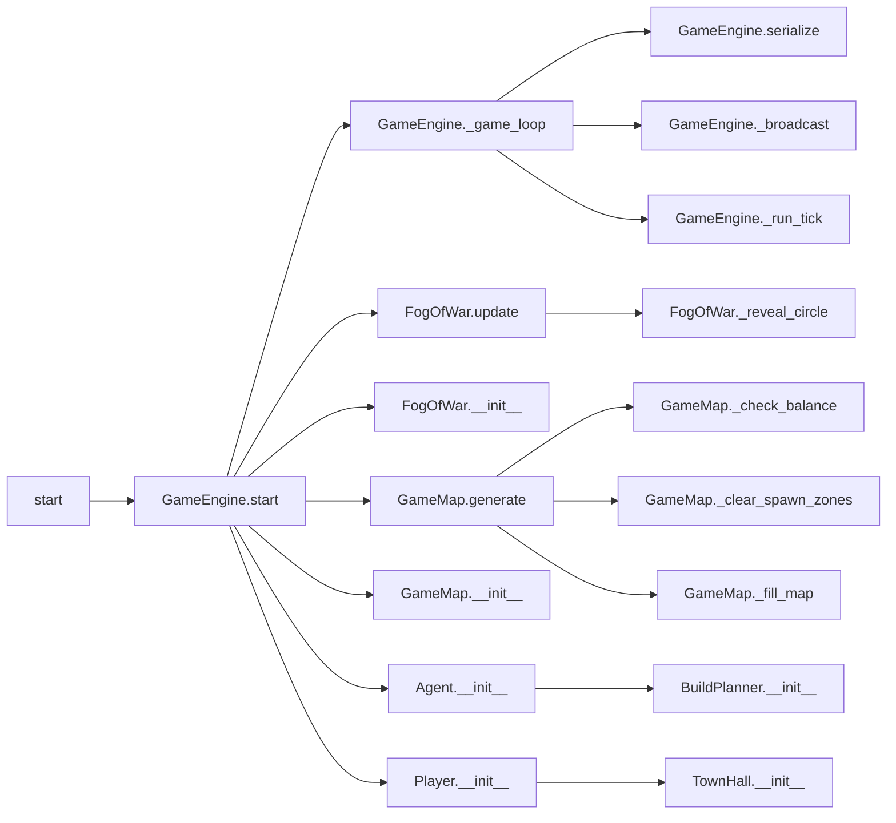
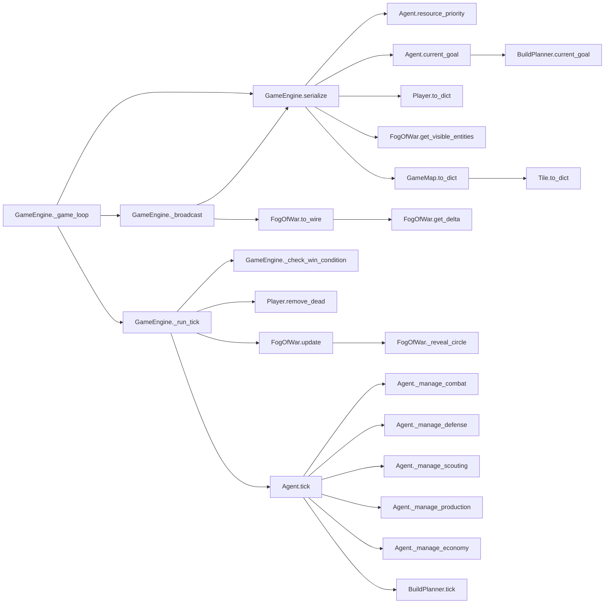
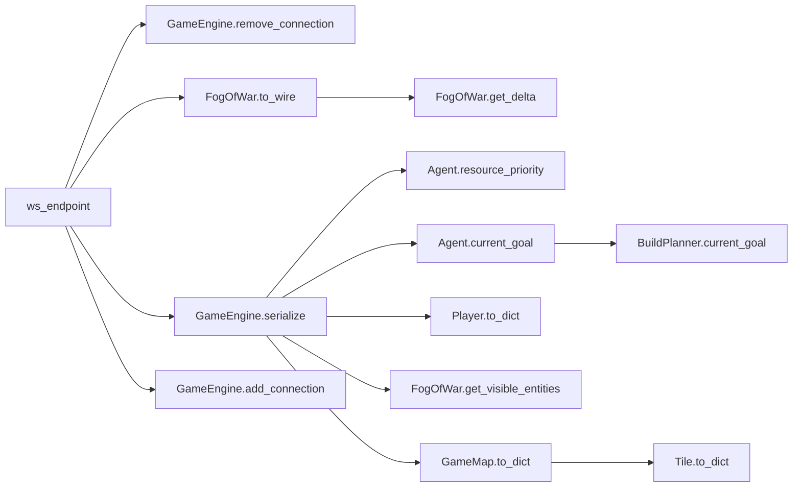

# View 09: Code Graph

**Project**: ejaj-boj (the owner's earlier parametric-RTS project, pinned `fde9d3c`)  
**Generated**: 2026-11-15  
**Backend**: SQLite (`code/ejaj-boj/code_graph.sqlite`, gitignored, regenerate with the commands below)

## Executive Summary

| Metric | Value |
|---|---|
| Functions / methods / module bodies | 271 (Python 137, JavaScript 134) |
| Call edges | 326 (call 240, name-match 37, instantiates 28, property 9, reference 8, http 3, websocket 1) |
| Entry points | 57 (event 45, http 5, timer 3, websocket 1, script 1, framework 1, browser-load 1) |
| Dead-code candidates | 29 (10.7%); see [dead-code.md](../reports/dead-code.md) |
| Circular dependencies (function level) | 0 |
| Browser → server edges | 4 (HTTP/WebSocket calls resolved to the FastAPI handlers) |
| Source files | 17 Python + 11 JavaScript (the inline scripts of `client/index.html` plus 10 `client/lib/*.mjs`) |

> **Coverage confidence: Medium-High for project-internal calls, with named gaps.** Static, syntax-aware extraction (stdlib `ast` for Python, tree-sitter for JavaScript) with project-local type resolution; no type checker was run. Tests are outside the graph by design; the dead-code report shows which candidates tests still use.

> **Scope decisions** (the skill's interactive dialogue was answered by the analyst, as for deep-rts): single repo `ejaj-boj` at the pinned SHA; unified SQLite graph; all outputs; tests, the AI-crew tooling (`crew/`, `.quantum-*`, `.local-skills/`) and `run-crew.sh` excluded.

## Extraction Summary

| Language | Tool | Tier | Note |
|---|---|---|---|
| Python | stdlib `ast` + project-local resolution (annotations, constructor calls, `self` fields, MRO, class-hierarchy dispatch, properties, unique-method-name fallback) (`scripts/cg-ejaj-boj.py`) | 2 | No type checker run. pyan3 2.9.0 is the skill's tier-1 tool; it **was run** as a cross-check (below), not merged |
| JavaScript | `tree-sitter-javascript` 0.25.0 on `client/lib/*.mjs` and the inline `<script>` blocks of `client/index.html` (line numbers preserved) | 2 | Classes, object-literal methods, arrow functions and event/timer callbacks are nodes; `this`, global-instance and import resolution; DOM/Canvas/builtin calls are `external-package` by an allowlist of names |
| Browser → server | `fetch('/path')` and `new WebSocket(.../ws)` matched to FastAPI route decorators | n/a | edge types `http` / `websocket`; table `routes` |

### Resolution heuristics worth knowing

- **Flow-insensitive typing**: the last typed assignment to a local wins; no `isinstance` narrowing.
- **Bare `list` annotations lose element types.** `Player.units` and `Player.buildings` are annotated `list`, so loops over them have untyped elements. The extractor falls back to **unique-method-name matching** (`name-match` edges, `is_dynamic=1`) when a method name has 1-3 definers in the project (`move_towards`, `step_path`, `distance_to`, `take_damage`). Names with more definers (`to_dict`) stay unresolved. These edges are real calls in the source I read but are heuristic; the scorecard reports them separately.
- A method whose name appears in an unresolved call site is **not** reported as dead (it may be the target): see the dead-code report.

## Coverage Scorecard

| Metric | Value | Reason for any gap |
|---|---|---|
| repoCoverage | 1/1 (100%) | `learning-rts` has no code to analyse |
| languageCoverage | 2/3 (67%) | Python and JavaScript extracted; **Bash** (`run-crew.sh`, the AI-crew runner) is not game code and was not extracted. HTML/CSS are markup, not call graph |
| crossRepoMechanismCoverage | n/a (0/0) | single repo; the one cross-boundary mechanism (browser → server HTTP/WebSocket) is resolved into edges inside the repo |
| edgeResolutionCoverage (blended, strict: every external call in the denominator) | 23.8% | dominated by builtin/stdlib/DOM calls, expected |
| edgeResolutionCoverage (project-internal only, typed) | 85.5% | see per language |
| edgeResolutionCoverage (project-internal, incl. unique-name matches) | 97.2% | |

| Language | Resolved (typed) | Name-match call sites | Unresolved | of which external | Strict % | Project-only % | Project-only % incl. name-match |
|---|---|---|---|---|---|---|---|
| python | 164 | 37 | 349 | 345 | 29.8% | 80.0% | 98.0% |
| javascript | 108 | 0 | 485 | 480 | 18.2% | 95.6% | 95.6% |

| Unresolved reason | Python | JavaScript | Meaning |
|---|---|---|---|
| `external-package` | 345 | 480 | stdlib, builtins, FastAPI/uvicorn, DOM, Canvas, `Math`/`JSON`; expected, not a gap |
| `type-alias` | 4 | 1 | receiver type unknown and the method name is ambiguous or builtin-like |
| `dynamic` | 0 | 4 | callbacks passed as parameters (`onZoom`, `resolve`) or non-name callees |
| `missing-repo` | 0 | 0 | none |

### pyan3 cross-check (Python)

pyan3 2.9.0 was run on the same files and compared with this graph's Python→Python edges: **119 edges agree**, 20 are pyan3-only, 26 are only in this graph. Agreement: 85.6% of pyan3's edges, 82.1% of this graph's. (The column name `treesitter_only` in table `pyan_crosscheck` is inherited from the deep-rts script; the Python side here uses `ast`.)

What I checked by reading the source for the disagreements (`SELECT * FROM pyan_crosscheck WHERE verdict != 'both'`):

- **All 20 pyan3-only edges are false or non-calls** (I read each caller). 16 are `Method → Class.__init__` edges from methods that neither construct their own class nor call `__init__` (the likely cause is pyan3's attribute-use tracking; not verified), 2 are self-loops (`Agent.__init__`, `create_placeholder_assets`), and `Entity.to_dict → _new_id` and `Unit.step_path → Unit.move_towards` do not exist in the code.
- The 26 graph-only edges are mostly the `name-match` edges and calls pyan3 cannot type (`for agent in self.agents: agent.tick(...)` → `Agent.tick`, which is a real edge pyan3 misses).
- Conclusion: for this codebase the in-house extractor is at least as accurate as pyan3; pyan3 stays a cross-check.

## Complexity Hotspots (cyclomatic complexity > 10)

| # | Function | CC | Location |
|---|---|---|---|
| 1 | `Agent._manage_production` | 58 | `server/ai/agent.py:316` |
| 2 | `GameClient._buildTileCache` | 36 | `client/index.html:831` |
| 3 | `Agent._manage_combat` | 32 | `server/ai/agent.py:688` |
| 4 | `Agent._manage_scouting` | 26 | `server/ai/agent.py:524` |
| 5 | `GameClient._initPointerEvents` | 24 | `client/index.html:1311` |
| 6 | `Agent._manage_defense` | 22 | `server/ai/agent.py:613` |
| 7 | `assign_workers` | 19 | `server/ai/economy.py:129` |
| 8 | `GameClient._renderMinimap` | 19 | `client/index.html:1223` |
| 9 | `GameClient._updateUI` | 17 | `client/index.html:704` |
| 10 | `GameEngine.serialize` | 16 | `server/core/game_engine.py:193` |
| 11 | `find_path` | 14 | `server/core/pathfinding.py:15` |
| 12 | `GameMap._place_water_zones` | 13 | `server/maps/game_map.py:100` |
| 13 | `_computeRockTiles` | 13 | `client/index.html:550` |
| 14 | `GameClient._renderBuildQueue` | 13 | `client/index.html:1136` |
| 15 | `buildParamRows` | 13 | `client/index.html:1502` |
| 16 | `GameClient._hitTest` | 12 | `client/index.html:1290` |
| 17 | `GameClient._initPointerEvents.<handler:mousemove@1319>` | 12 | `client/index.html:1319` |
| 18 | `_nearest_unexplored_tile` | 11 | `server/ai/agent.py:174` |
| 19 | `BuildPlanner.resource_priority` | 11 | `server/ai/build_planner.py:181` |
| 20 | `GameClient.connect` | 11 | `client/index.html:1412` |

CC counts `if`, ternary, loops, `except`, `assert`, boolean operators and comprehension clauses (Python) or the tree-sitter equivalents (JavaScript). `Agent._manage_production` at 58 is the outlier: the whole build/scout/train policy is one method.

## High Fan-in (most-called)

| # | Function | Fan-in | Fan-out | Note |
|---|---|---|---|---|
| 1 | `Unit.move_towards` | 22 | 1 | includes 17 name-match edges |
| 2 | `Unit.step_path` | 15 | 0 | includes 11 name-match edges |
| 3 | `GameClient.render` | 10 | 8 |  |
| 4 | `Entity.distance_to` | 9 | 0 | includes 7 name-match edges |
| 5 | `_combat_units` | 7 | 0 |  |
| 6 | `_townhall_pos` | 6 | 0 |  |
| 7 | `_worker_units` | 6 | 0 |  |
| 8 | `Goal.__init__` | 6 | 0 |  |
| 9 | `Player.barracks_list` | 6 | 0 |  |
| 10 | `worldToScreen` | 6 | 0 |  |

## High Fan-out (coordination)

| # | Function | Fan-out | CC |
|---|---|---|---|
| 1 | `Agent._manage_production` | 25 | 58 |
| 2 | `Agent._manage_combat` | 25 | 32 |
| 3 | `Agent._manage_scouting` | 16 | 26 |
| 4 | `assign_workers` | 12 | 19 |
| 5 | `GameEngine.start` | 9 | 6 |
| 6 | `<module>` | 9 | 1 |
| 7 | `GameClient.render` | 8 | 7 |
| 8 | `Agent.tick` | 6 | 1 |

## Circular Dependencies

0 cycles at function level (Tarjan SCC over all edge types; checked on the whole graph, not only from entry points). No recursion, no mutual recursion.

## Browser ↔ Server Boundary

| Client node | Edge | Server handler |
|---|---|---|
| `GameClient.postReset` | http | `reset` |
| `GameClient.postStart` | http | `start` |
| `ReplayController.open` | http | `get_replay` |
| `GameClient.connect` | websocket | `ws_endpoint` |

Routes: `GET /`; `GET /health`; `POST /start`; `POST /reset`; `GET /replay`; `WS /ws`. The server also mounts static directories `/lib` and `/assets` (not call edges). There is no client → server message over the WebSocket: the handler reads and discards every received frame.

## Dead Code Summary

29 candidates (10.7%): Python 11, JavaScript 18. 6 further methods were **not** counted because their name appears at an unresolved call site. Full inventory with test references: [dead-code.md](../reports/dead-code.md).

## Call Graph Diagrams (entry traces, depth 3)

### POST /start



Dotted arrows are heuristic (`name-match`) or virtual-dispatch edges.

### Game loop (asyncio task started by GameEngine.start)



Dotted arrows are heuristic (`name-match`) or virtual-dispatch edges.

### WS /ws



Dotted arrows are heuristic (`name-match`) or virtual-dispatch edges.

## Regeneration

```bash
venv/bin/python scripts/cg-ejaj-boj.py && venv/bin/python scripts/cg-pyan-crosscheck.py ejaj-boj && venv/bin/python scripts/cg-ejaj-boj-reports.py
```

