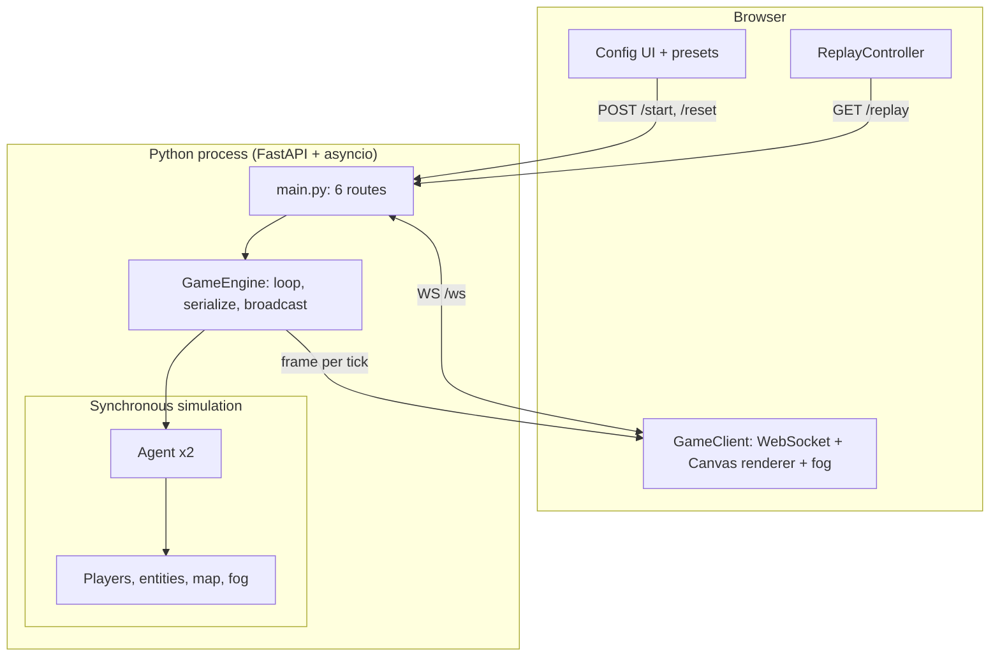

# Architecture Documentation: ejaj-boj

**Project**: ejaj-boj ("AI Battle"), the owner's earlier parametric-RTS project. A sibling of deep-rts in the metarepo: read-only here, pinned, analysed for what it teaches `learning-rts`.
**Repository**: `git@github.com:quantum-crowbar/ejaj-boj.git`, branch `master`, pinned `fde9d3c` (2026-03-21; 111 commits in 15 days)
**Analysis date**: 2026-11-15
**Analysed by**: AI agent, quantum-toolbox v3.3.1 `arch-analysis` + `code-graph` skills

---

## Executive Summary

ejaj-boj is a small, working game: a Python 3.12 / FastAPI / asyncio server (2,767 lines) runs **one match between two parametric AI agents** at 10 ticks/s and streams it over a WebSocket to a vanilla-JavaScript canvas client (1,894-line `index.html` plus 10 library modules). The human only tunes an 18-key parameter dict and watches. It has fog of war, A* pathfinding, seeded map generation, a replay viewer, and CC0 sprite art with recorded provenance. It has no database, no auth and no external services.

**It runs.** From a fresh clone it installs with current, unpinned dependencies and passes **456 tests in 3.2 s**; a full match runs headless at about **2,700 ticks/s on one core** (*ran*). Findings are therefore about robustness and design, not about whether it works: an exception in a tick leaves the engine permanently "running" (reachable with one bad parameter), the fog protocol breaks for any client that connects after the first, four client modules are never imported by the page, inputs are unvalidated, runs are reproducible only if a global id counter is reset, and the documentation is 54% accurate in its details.

The code graph (271 functions, 326 edges, SQLite) shows a clean layering (transport → orchestration → synchronous simulation), **no function-level cycles**, and one complexity outlier: `Agent._manage_production` at cyclomatic complexity 58.

### Quick Stats

| Metric | Value |
|--------|-------|
| Languages | Python 3.12 (2,865 prod lines), JavaScript ES modules (~3,100 lines), HTML/CSS inline |
| Frameworks | FastAPI, uvicorn, websockets; no client framework, no build step |
| Functions / call edges | 271 / 326 (graph) |
| Entry points | 57 (45 browser events, 5 HTTP, 1 WebSocket, 3 timers, 3 other) |
| API surface | 6 routes (`/`, `/health`, `POST /start`, `/reset`, `GET /replay`, `WS /ws`) |
| Tests | 456 pytest pass (1 skipped), 142/143 client JS pass |
| Dependencies | 6 Python packages (unpinned, tests mixed in), 1 npm dev dependency |
| Builds / runs | **Yes** |

### Health Overview

| Area | Status | Notes |
|------|--------|-------|
| Dependencies | 🟡 | unpinned, no lockfile, but works today; 0 advisories at resolved versions; no licence file |
| Documentation | 🟡 | 54% claim accuracy; structure right, details drifted |
| Error handling | 🔴 | one silent-failure mode (dead loop, engine stuck `running`) |
| Security | 🟡 | no auth, CORS `*`: fine locally, not if exposed |
| Architecture | 🟢 | clean layering, no cycles, simulation is synchronous and testable; agent code is monolithic |
| Testing | 🟢 | 456 fast tests; e2e not run here |

---

## Analysis Results

| # | Document | Status | Description |
|---|----------|--------|-------------|
| 1 | [Technology Manifest](analysis/01-technology-manifest.md) | ✅ | stack, dependencies, build |
| 2 | [Interface Specification](analysis/02-interface-specification.md) | ⚠️ | routes, WebSocket protocol, fog contract, the 18-key parameter contract |
| 3 | [Architecture Diagrams](analysis/03-architecture-diagrams.md) | ✅ | layers, class hierarchy, 4 sequence diagrams |
| 4 | [Documentation Audit](analysis/04-documentation-audit.md) | ⚠️ | 36-claim ledger, 54% accuracy |
| 5 | [Dependency Health](analysis/05-dependency-health.md) | 🟡 | versions, advisories, licence, security observations |
| 6 | [Data Flow Map](analysis/06-data-flow-map.md) | ✅ | in-memory flow, lifecycle, data-quality observations |
| 7 | [Error Handling](analysis/07-error-handling.md) | ⚠️ | mechanisms and 9 failure modes |
| 9 | [Code Graph](analysis/09-code-graph.md) | ✅ | View 09: SQLite call graph, scorecard with named gaps |

Reports: [Findings Summary](reports/findings-summary.md) · [Entry Point Map](reports/entry-point-map.md) · [Dead Code](reports/dead-code.md) · [SQLite Cookbook](reports/sqlite-cookbook.md). *Not generated:* `sre-hot-paths.md` (requires SRE view 08, which `arch-analysis` does not produce).

**Status legend**: ✅ complete · ⚠️ issues found · 🟡 minor issues

---

## Key Findings

### Critical issues

None that stop it working. The most serious is **E1**: an exception inside a tick ends the game loop while the engine still reports `running`, so the match freezes and `POST /start` returns 409 until `POST /reset`. One bad parameter value triggers it. → [07](analysis/07-error-handling.md)

### Recommendations

| Priority | Recommendation | Effort | Impact |
|----------|----------------|--------|--------|
| High | Set an `error` state when the game loop dies; validate `/start` parameters | S | removes the only silent-failure path |
| High | Send a full fog grid to every new connection | S | fixes refresh / second tab / reconnect |
| Medium | Stop sending the full map each tick (send once, then only changed tiles) | M | about 97% less traffic |
| Medium | Wire in or delete `anim`, `fx`, `camera-helpers` | S | animations are an open spec |
| Medium | Store seed, parameters and a version in replays; do not delete on reset | S | replays become reproducible |
| Low | Split `_manage_production`; unify the attack rule | M | maintainability |
| Low | Add licence, lockfile, CI | S | |

---

## Architecture Overview

---

## Navigation

- **How does the game work end to end?** → [Architecture Diagrams](analysis/03-architecture-diagrams.md)
- **What are the parameters and the wire protocol?** → [Interface Specification](analysis/02-interface-specification.md)
- **Can I trust the docs?** → [Documentation Audit](analysis/04-documentation-audit.md)
- **What breaks and how?** → [Error Handling](analysis/07-error-handling.md)
- **What would a reuse (e.g. in learning-rts) need to know?** → [Findings Summary, last section](reports/findings-summary.md)
- **Query the code yourself** → [SQLite Cookbook](reports/sqlite-cookbook.md), database at `code/ejaj-boj/code_graph.sqlite`

### Related documentation

- The project's own docs (inside `code/ejaj-boj/`): `AGENTS.md`, `CONTEXT.md`, `specs/EJAJ_BOJ_SPEC.md`, `roadmaps/master-roadmap.md`
- Sibling analysis: [deep-rts](../../architecture-docs/index.md)
- Design docs for the new project: [docs/general/](../../general/README.md)

---

## Analysis Metadata

| Field | Value |
|-------|-------|
| Analysis tool | AI agent: arch-analysis + code-graph skills (quantum-toolbox v3.3.1); structure follows the skill's templates |
| Files analysed | 17 Python + 11 JavaScript files in the graph; `AGENTS.md`, `CONTEXT.md`, `CREDITS.md`, `Dockerfile`, manifests and the specs index read; tests used as evidence, not graphed |
| Commit | `fde9d3c` (branch `master`) |
| Executed during analysis | the 456-test suite and the FE/JS test files; headless matches (determinism, throughput, balance, outcomes); an injected-exception run; a bad-parameter run; a map-generation sweep; deepcopy timing; OSV advisory queries (package names/versions only). All outside the clone, in a scratch environment |
| Not done | no browser run (Playwright e2e, visual check, `file://` behaviour); no stress test of slow clients; npm advisories; Docker build; `specs/`, `crew/` and the roadmap not audited line by line |
| Interactive-dialogue choices | docs dir `docs/ejaj-boj/`; Mermaid; code-graph scope: single repo, unified SQLite, all outputs |

---

*Generated by the arch-analysis skill. Scripts: `scripts/cg-ejaj-boj.py`, `scripts/cg-ejaj-boj-reports.py`, `scripts/cg-pyan-crosscheck.py ejaj-boj`.*
