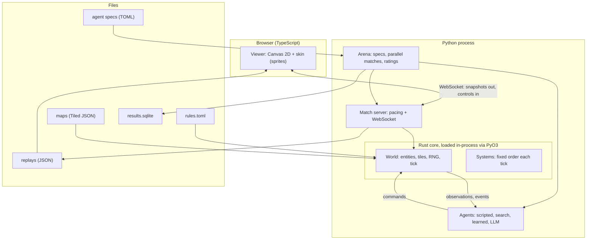
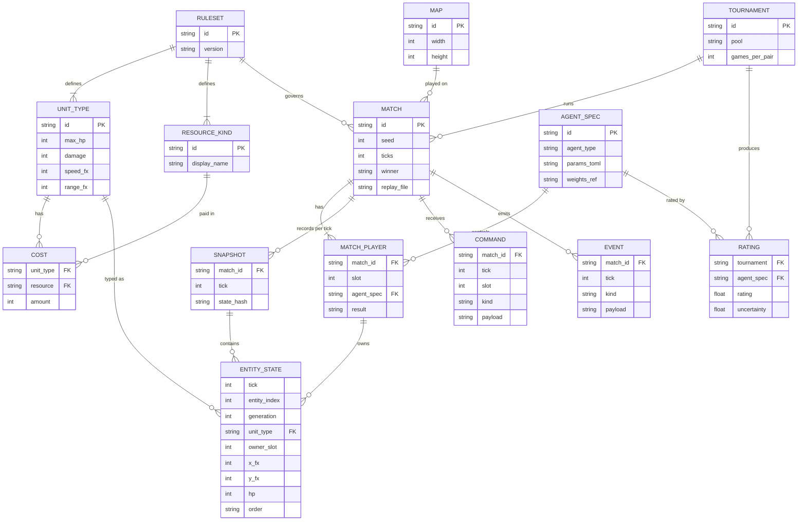
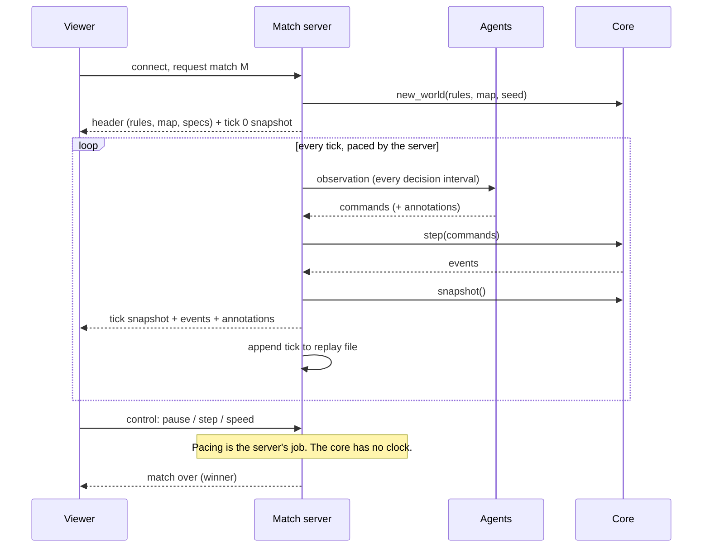
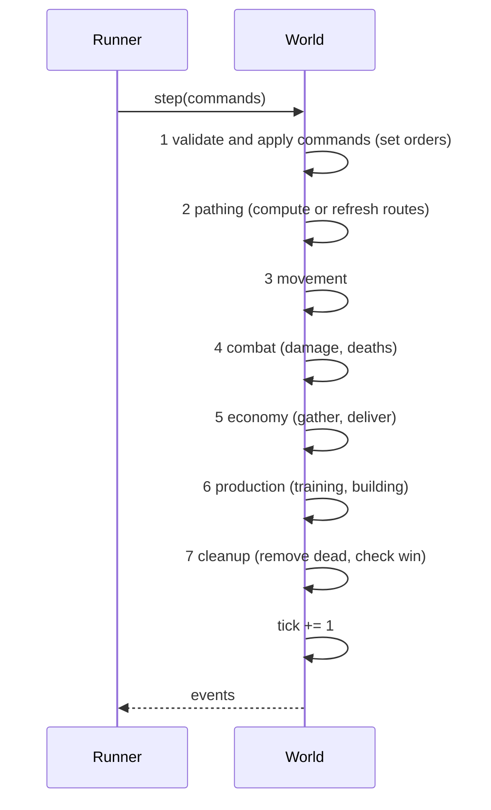
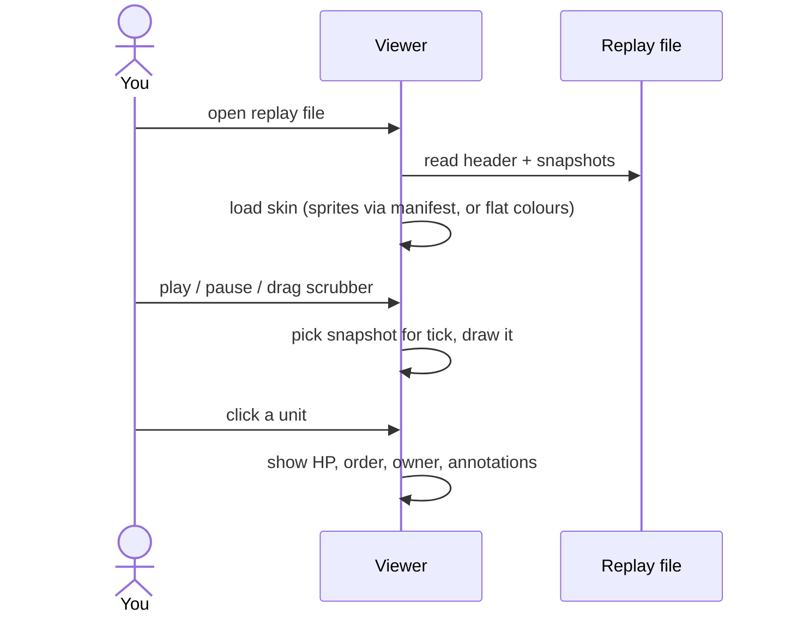
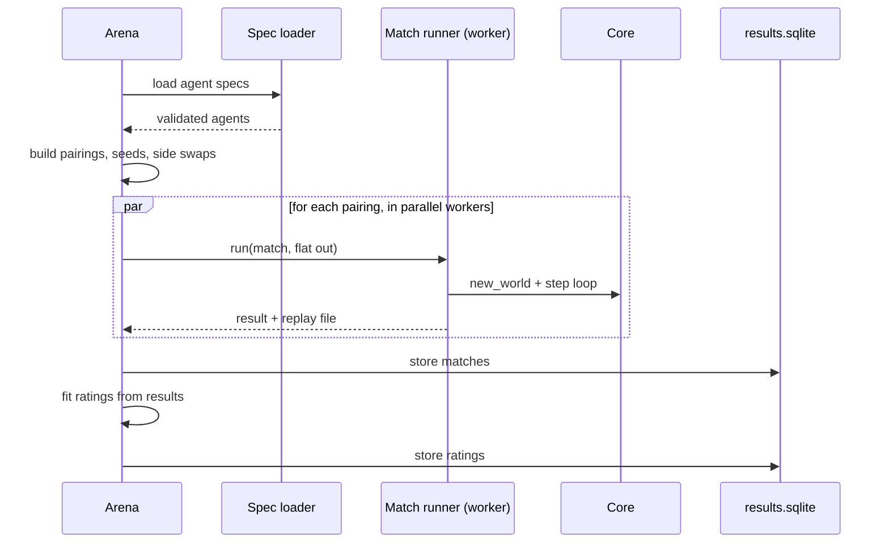
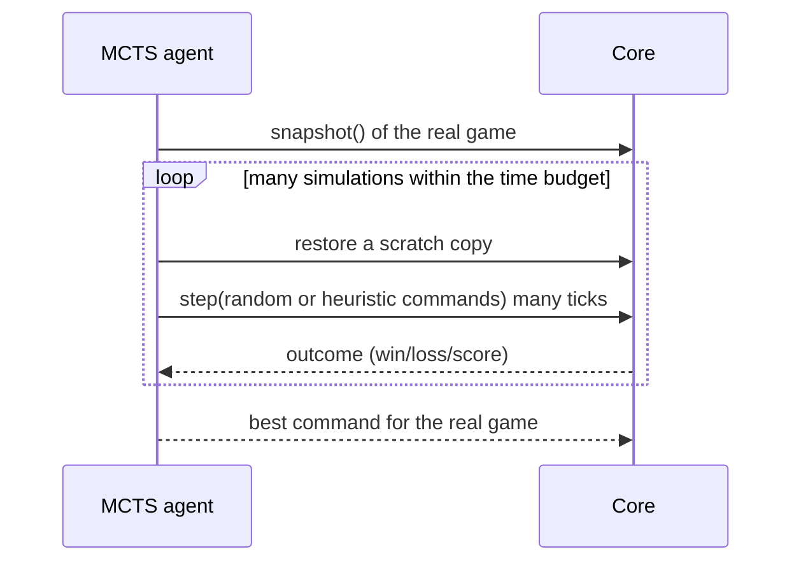

# Architecture

Status: design, 2026-11-15. **Nothing here is implemented.** Decision status (decided / proposed / open) for each point is in [decisions.md](decisions.md); IDs like D14 refer to it. Code sketches are **illustrative and have not been compiled** (no Rust toolchain is installed yet, Q08).

## 1. Overview

One sentence: a deterministic Rust simulation that only moves forward when told to, wrapped by Python (agents, arena, match server) and watched through a TypeScript browser viewer.



**Why this shape (D07, D10-D12).** The Rust core is the only part where speed and exactness matter, because evolution and tree search will run it millions of times. Everything that benefits from fast iteration (bots, tournaments, learning) is Python. The viewer is a browser page so it works for live play, replays and several spectators. The core and Python live in **one process**: PyO3 lets Python call Rust functions directly, with no network and no serialization between them. Only the viewer is across a network boundary.

### Component responsibilities

| Component | Language | Owns | Must never |
|-----------|----------|------|------------|
| Sim core | Rust | World state, rules, `step`, state hash, snapshot/restore | Read a clock, touch files or network, use global state, use floats (D14, D15) |
| Agent API | Python | The contract between agents and the core (observation in, commands out) | Mutate the world directly |
| Agents | Python (some later Rust) | Decisions | Peek at state they were not given |
| Match server | Python | Pacing, streaming, writing the replay | Contain game rules |
| Arena | Python | Specs, seeds, side swapping, ratings, results | Contain game rules |
| Viewer | TypeScript | Drawing, controls, replay scrubbing | Contain game rules (it only reads snapshots) |

## 2. Data model

Logical model (not all of it is a database; see the storage column below).



| Entity | Storage (D13, D20, D25) | Notes |
|--------|-------------------------|-------|
| RULESET, UNIT_TYPE, RESOURCE_KIND, COST | `rules.toml` | Loaded once into the core; resource kinds are a table so adding wood/stone is a data change (D06) |
| MAP | Tiled JSON | deep-rts maps reused, converted if needed |
| AGENT_SPEC | one TOML file per agent | Q02 |
| MATCH, MATCH_PLAYER, TOURNAMENT, RATING | SQLite `results.sqlite` | Written by the arena |
| SNAPSHOT, ENTITY_STATE | inside the replay JSON | Per-tick snapshots in v1 (D20) |
| COMMAND, EVENT | in the replay; commands also enable the later command-log replay | |

Positions are `*_fx`: **fixed-point integers** (D15). One tile = 256 units, as a working assumption; the exact scale is not decided.

## 3. Sequences

### 3.1 Watching a live match



### 3.2 One tick inside the core

The order is fixed, so the same inputs always produce the same result (D14). The order below is a **proposal**; the reasons are my design judgement and are not validated by running anything.



### 3.3 Watching a replay



The viewer never runs the game. It only draws snapshots, so it cannot disagree with the sim.

### 3.4 A tournament in the arena



### 3.5 A search agent (MCTS) using snapshot/restore



This is why snapshot/restore is a core requirement (D18): search copies the world thousands of times per decision.

## 4. How the main parts work

### Time and determinism
The core has a tick counter and nothing else about time. `step(commands)` advances exactly one tick. The same ruleset, map, seed and command sequence must produce the same **state hash** at every tick; the first test of the core (M1) checks this across runs and across machines. Anything that could differ between machines is banned from the core: wall clocks, floats (D15), hash-map iteration order, threads inside a step.

### Commands, events, observations, rewards
- Agents send **commands**; the core validates them (cost, range, ownership) and turns valid ones into unit orders. Invalid commands are rejected with a reason, not silently ignored (deep-rts silently no-ops).
- The core returns **events** describing what happened.
- **Observations** are built from state on demand by an *observer*, so they can never be stale (deep-rts's health/state/carry channels were).
- **Rewards** are functions over events and state, return real numbers, and can be negative.
- **Termination** is a pure function of state: asking twice changes nothing.

### Storage of entities (D17)
Each field is its own array, indexed by a row number (struct of arrays). A handle to an entity is `(index, generation)`; when a row is reused the generation changes, so an old handle is recognised as stale. There are no pointers to units, so the deep-rts class of bug (pointers into a vector that is later resized) cannot occur.

### Pacing
The runner decides how fast to call `step`: real time for watching, faster for demos, as fast as possible for tournaments. Slow agents (search, LLM) get a **decision interval** (ask every N ticks) and the match waits for them; wall-clock watching is therefore only smooth with fast agents.

### Replays (D20)
Header (format version, ruleset version, map, seed, agent specs) followed by one snapshot per tick. A sketch, not a fixed format (Q03):

```json
{
  "format": 1,
  "ruleset": "v0.1",
  "map": "15x15-2p-ffa-Cresal",
  "seed": 42,
  "players": [{"slot": 0, "spec": "rush-v1"}, {"slot": 1, "spec": "boom-v1"}],
  "ticks": [
    {"tick": 0, "hash": "…", "entities": [], "events": [], "annotations": []}
  ]
}
```

Later the replay can shrink to the header plus the command log, with the core compiled to WASM so the viewer re-simulates it exactly.

### Skins (D05, D23)
The viewer asks a skin "which image and frame for unit type X facing direction D at animation step N". The DeepRTS skin maps these to the sprite sheets through a manifest; the placeholder skin draws coloured shapes. Because the sprites are not committed, the project must never depend on them.

## 5. Code sketches (not compiled)

**Rust: how entities are stored.** Read this as the "shape" of the core.

```rust
/// A handle to an entity. `index` is the row in the arrays below;
/// `generation` changes every time that row is reused, so a stale handle
/// can be detected instead of silently pointing at a different unit.
#[derive(Clone, Copy, PartialEq, Eq, Debug)]
pub struct EntityId {
    index: u32,
    generation: u32,
}

/// Fixed-point number: the integer counts 1/256 of a tile.
/// Integer arithmetic gives identical results on every machine.
#[derive(Clone, Copy, PartialEq, Eq, PartialOrd, Ord, Debug)]
pub struct Fx(i32);

/// Struct of arrays: one `Vec` per field, all indexed by the same row.
#[derive(Clone)] // `Clone` is what makes snapshot() a one-liner
pub struct Entities {
    alive: Vec<bool>,
    generation: Vec<u32>,
    owner: Vec<u8>,
    x: Vec<Fx>,
    y: Vec<Fx>,
    hp: Vec<i32>,
    free_rows: Vec<u32>, // rows of dead entities that can be reused
}

impl Entities {
    /// `&self` = a shared, read-only borrow: the method can look but not change.
    pub fn is_valid(&self, id: EntityId) -> bool {
        let i = id.index as usize;
        i < self.alive.len() && self.alive[i] && self.generation[i] == id.generation
    }
}
```

What to notice (compared with C++):
- `Vec<T>` is `std::vector<T>`. Indexing out of range **panics** (a controlled crash with a message) instead of being undefined behaviour.
- `#[derive(Clone)]` generates a deep copy for the whole struct. In C++ you would write or rely on a copy constructor; here the compiler writes it, so a snapshot is `world.clone()`.
- `&self` versus `&mut self` is the core Rust idea: the signature says whether a method can change the object, and the compiler checks it.

**Rust: the shape of the step function.**

```rust
pub enum Command {
    Train  { building: EntityId, unit_type: UnitTypeId },
    Move   { units: Vec<EntityId>, to: TilePos },
    Attack { units: Vec<EntityId>, target: EntityId },
    Gather { units: Vec<EntityId>, node: EntityId },
}

pub enum Event {
    UnitKilled        { victim: EntityId, killer: Option<EntityId> },
    ResourceDelivered { player: PlayerId, kind: ResourceKind, amount: i32 },
    PlayerDefeated    { player: PlayerId },
}

impl World {
    /// `&mut self`: exclusive access, because stepping changes the world.
    /// `commands: &[...]`: a borrowed view of the commands; we only read them.
    pub fn step(&mut self, commands: &[(PlayerId, Command)]) -> Vec<Event> {
        // 1 apply commands, 2 pathing, 3 movement, 4 combat,
        // 5 economy, 6 production, 7 cleanup (see section 3.2)
        todo!()
    }

    pub fn state_hash(&self) -> u64 { todo!() }
}
// Types such as TilePos, UnitTypeId, PlayerId and ResourceKind are not shown.
```

What to notice:
- A Rust `enum` variant can carry data, so `Command` and `Event` are closed, typed sets. The compiler forces every `match` over them to handle every variant, so adding a new command later shows you every place that must change.
- `Option<EntityId>` replaces a null pointer: a kill may have no killer (starvation, say), and the type makes you handle that.
- `todo!()` is a placeholder that compiles and panics if reached.

**Python: what an agent looks like.**

```python
class Agent(Protocol):
    def reset(self, spec: dict, player: int, rules: Rules) -> None: ...
    def decide(self, obs: Observation) -> list[Command]: ...
    def annotations(self) -> list[Annotation]:   # optional: drawn by the viewer
        return []
```

**TOML: a ruleset fragment and an agent spec.** The numbers are placeholders, not extracted from deep-rts yet (Q01).

```toml
# rules.toml
[resources.gold]
display_name = "Gold"

[units.footman]
max_hp = 60
damage = 6
cost = { gold = 600 }
```

```toml
# specs/rush-v1.toml
[agent]
type = "scripted.rush"
name = "rush-v1"

[params]
workers_before_attack = 4
attack_wave_size = 6
```

## 6. Failure modes and what they bet on

| Risk | What it assumes | If wrong |
|------|-----------------|----------|
| Determinism holds across machines | Integer math and fixed iteration order are enough | Hash mismatch in the M1 test; find the non-deterministic source before building further |
| Python can pace and stream fast enough (D11) | Small snapshots, a few spectators | Move the server to Rust, or send deltas instead of full snapshots |
| Per-tick snapshots in the replay stay small (D20) | A small game with a few hundred entities | Compress, delta-encode, or switch to a command log + WASM |
| Rust learning curve is acceptable (D07) | Struct-of-arrays avoids the worst borrow-checker friction | Prototype in Python behind the same interfaces, rewrite later |
| Throughput is enough for evolution and search | Unmeasured | Smaller game, fewer simulations per decision, or rent a GPU/cloud box for learning (M6) |
| Sprite sheets map cleanly to the skin manifest (Q04) | Regular frame grid | Placeholder skin until mapped; hand-built manifest |

## 7. What we deliberately do differently from deep-rts

Defects found while analysing deep-rts, our inspiration, that shaped this design.

| deep-rts defect (see [findings](../architecture-docs/reports/findings-summary.md)) | How our design avoids it |
|-------------------------------------------------------------------------------------|------------------------|
| Boolean `all_of` scenario rewards | Rewards are real-valued functions over events (D16) |
| Observation channels written only on `setPosition`, so they go stale | Observations computed on demand from state (D16) |
| `isTerminal()` has side effects and can fail to terminate | Termination is a pure function of state (D16) |
| Step gated by wall clock, 60 steps/s default | No clock in the core; pacing in the runner (D14) |
| Python subclass overrides sliced on insert | Agents are separate objects behind an API, not subclasses of core types (D10) |
| `spawn_unit` returns a copy | Commands return ids and events; handles are `(index, generation)` (D17) |
| Pointers into a `vector<Unit>` | No pointers to entities (D17) |

Each row becomes a test in the core's test suite (roadmap, "Using deep-rts").
