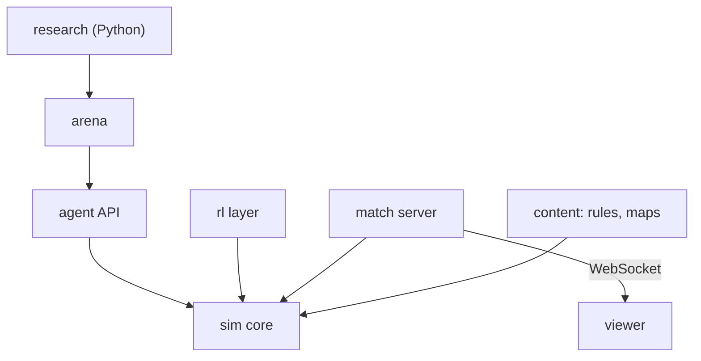

# learning-rts roadmap

Status: draft, 2026-11-14. Nothing below is built yet. Decisions marked **open** are not made.

## Goal

A small deterministic RTS in which **parametrized agents play each other**: I supply an agent spec (type, parameters, optional weights), the arena runs seeded matches and reports rated results, and **I can watch every game**, live or as a replay. The purpose is to learn how game AI is built, from scripted bots up to search and learned agents. Matching the original DeepRTS rules or paper is explicitly **not** a goal.

## Requirements (fixed by me)

1. **Watch games live**: a server plays the match in front of me.
2. **Watch games afterwards**: replay with scrubbing, from a file.
3. **DeepRTS sprites are used from the start and for the foreseeable future** (see "Sprites" for the caveat).
4. Agents are specs: one file in, rated result out.

## Progress

State as of 2026-11-16, after one overnight build session. The code is in the deep-strategy repository (`code/learning-rts/` here).

| Milestone | State | Evidence / caveat |
|-----------|-------|-------------------|
| M0 | partly | Rules extracted into `data/rules.toml` (my own v1 numbers, not diffed against deep-rts); Rust toolchain **not installed**; no one-page design doc beyond `docs/general/` |
| M1 | **done except the two-machine gate** | 33 tests pass, including same-seed-same-hash, snapshot/restore continuing identically, observation isolation, invalid commands never raising. Measured: about 5,200 ticks/s per core (agents are 10% of that), snapshot 0.24 ms (7 KB), state hash 0.4 ms. Two-machine determinism **not tested** |
| M1b | **done** | Replay file (header + per-tick entity rows), one canvas viewer with play/pause/step/speed/scrubber/click-to-inspect and agent notes. Sprites: CC0 Tiny Swords via `scripts/setup_skin.py` plus a flat placeholder skin. Rendered in headless Chrome and looked at; **not** exercised by hand in a real browser. A 1,271-tick replay is 650 KB |
| M1c | **done** | WebSocket server streams a paced match, pause/step/speed work, every live match writes a replay; late joiners get hello + latest frame |
| M2 | **done (v1 rules)** | Gold economy, barracks, three unit types in a counter cycle, hall-destroyed win, time-limit tiebreak, draw on exact tie |
| M3 | **done** | Schema-validated TOML specs, 4 hand-written agents, arena with side swap, SQLite, sequential Elo, agent annotations (notes) in the viewer. A crashing or garbage-returning agent forfeits one match only (tested) |
| M3b | **not done** | Wood and stone not implemented. Decision D24 asks for it before M4; I did M4 first, so every rating and the evolved agent below are **discarded when M3b lands** |
| M3c | partly | Per-spectator mailbox (slow client skips frames, cannot block the match; tested with a client that never reads) and agent-note merging. **Not done:** reconnect with resume, per-tick deltas, measured bytes/s per viewer under load |
| M4 | **built; the result is not a real win** | `lrts/evolve.py` (mu+lambda ES, 12 generations, about 25 minutes) against the four hand-written agents. Score on 20 unseen maps: 0.94, versus 0.28-0.90 for the hand-written agents. **But it wins every one of its games at the time limit** (checked on 24 matches): it hoards army, sets `attack_size` 40, never attacks, and takes the time-limit tiebreak (hall hp, then army value). The optimiser found a hole in my rule, not a strategy. The exit gate ("beats the hand-tuned ones; non-transitive matchups visible") is met on paper and **not in spirit**. Hand-written agents do show a cycle (rush > boom, counter > rush, turtle > everything else) |
| M4b, M4c | **not done** | Need the Rust toolchain and teaching-mode sessions with me awake (D08) |
| M5, M6, M7 | **not done** | M5 is specified to run on the Rust core |

**Next step I recommend, before anything else:** make a time-limit finish a draw (or score it by damage dealt), rerun the arena and evolution, and see whether the evolved agent still wins. Until then no rating from this build means "better fighter". This is a design-rule question for me (a rule change invalidates the existing ratings).

## Three tracks

My goals, in order, map to three tracks that run through the same milestones. Each milestone below names the track it mainly serves.

| Track | Goal it serves | Language | What it teaches |
|-------|----------------|----------|-----------------|
| **AI** | 1. Game AI in strategy games | Python | Scripted bots, parameter evolution, search, learning, ratings |
| **RT** (real-time systems) | 3. Real-time systems | Python server, TypeScript viewer | Pacing, backpressure, snapshot plus delta, reconnect, interest management (fog), determinism and replay, load tests |
| **Rust** | 2. Rust | Rust | A bounded PyO3 module first, then the full core port against the Python sim as reference |

Order of work: the AI and RT tracks start immediately in Python, reusing ejaj-boj's concepts, 18-parameter agent and CC0 sprites. Rust enters at M4b as a small leaf module and takes over the sim core at M4c. The reasons are in decisions.md (D07, D26).

**What this bets on:** that a Python sim written to the design principles below can serve as an exact reference for the Rust port. If the Python sim is written loosely (globals, shared RNG, dict iteration order), the port has nothing to be checked against. The determinism test in M1 is what prevents that.

## Design principles

- Time is a tick counter. The core has no wall clock; pacing (real time, 4x, flat out) belongs to the match runner.
- The core mutates only through `step(commands)` and emits events. It never writes observations.
- Observations are computed from state on demand, so they cannot go stale. Rewards are functions over events. Termination is a pure function of state.
- Entities are rows in fixed-capacity arrays with generational ids: no pointers to units, and exceeding capacity is a defined error.
- Rules are data (TOML), not code. Resources are a table of kinds (`gold`, later `wood`, `stone`), not hard-coded fields, so adding one is a content change.
- Determinism is a tested contract: same seed plus same commands gives the same per-tick state hash.
- Snapshot/restore is a core feature (search agents and the viewer depend on it).
- Agents issue command-level actions ("train X", "send group G to P"), not per-unit-per-tick steering.
- Players are symmetric; single-agent is a wrapper around a scripted opponent.

## Architecture

- **research** (Python): baselines, self-play, evaluation.
- **arena**: spec loader, parallel seeded matches, side swap, ratings (Elo or Bradley-Terry).
- **agent API**: observation and legal commands in, commands (plus optional annotations) out.
- **rl layer**: observers, reward functions, action codec, scenarios.
- **match server**: owns pacing, streams snapshots over WebSocket, writes the replay.
- **sim core**: no I/O, clock or globals; world state, tile grid, seeded map generation, `step()`, `state_hash()`, snapshot/restore. A Python reference implementation until M4c, Rust after (D26).
- **content**: units, buildings, tiles and rules as TOML, maps as JSON.
- **viewer**: static HTML and JS in the browser; live and replay mode share one renderer.

Game scope for v1: about 32x32 maps, 3-4 unit types with counters (rock-paper-scissors), **gold only for the proof of concept**, no fog of war. The target economy is **gold, wood and stone**, added at M3b (below); deep-rts already has gold, lumber and stone tile types and yields, so the maps and sprites cover all three.

## Milestones

Each milestone has an exit gate that a run can fail.

| # | Track | Milestone | Exit gate |
|---|-------|-----------|-----------|
| M0 | all | One-page game design; ADRs (action space, agent spec, replay format); skin manifest format; rule constants into a TOML draft (ejaj-boj's `constants.py` first, deep-rts as cross-check); install the Rust toolchain and run hello-world | I can describe the full game and one winning strategy per matchup; Rust builds a trivial PyO3 module that Python imports |
| M1 | AI | **Python reference sim**: map loader, one mobile unit, pathfinding, tick loop, instance-owned seeded RNG (no globals), state hash, snapshot/restore | Determinism test: many seeds with random command streams give identical hashes across runs and across two machines. Throughput measured and recorded (ticks/s per core, snapshot cost) |
| M1b | RT | Replay writer and **viewer with sprites**: replay = header (rules version, map, seed, agent specs) + per-tick snapshots; play, pause, step, speed, scrubber, click-to-inspect | I open a replay of sprite units moving on a tile map and scrub through it |
| M1c | RT | **Live viewing**: match server streams ticks over WebSocket to the same viewer; pacing, pause/step/speed honoured by the runner; static map sent once, then deltas; every live match also writes a replay | I watch a match in the browser in real time and can rewatch it from the file |
| M2 | AI | Full rules with a **gold-only** economy: production, combat, win/lose | A scripted bot plays a complete game I can watch |
| M3 | AI | Agent API, spec loader (schema-validated), arena, ratings, first parametrized bots (rush, boom, turtle; the 18-parameter ejaj-boj agent re-expressed as a spec); annotations drawn in the viewer. A bot exception ends that match with a recorded result and never wedges the server | Two spec files in, a rated result out; I can see why an agent acted; a deliberately broken spec fails one match, not the server |
| M3b | AI | **Multi-resource economy: add wood and stone** (data-driven resource table, new costs and requirements, bots gain allocation parameters). Ratings from before M3b are discarded | Existing gold-only bots still run unmodified; a bot that ignores wood or stone is measurably beaten by one that balances them |
| M3c | RT | **Real-time hardening**: several spectators per match, slow-client backpressure (drop or coalesce, never block the sim), reconnect with resume, load test with a measured bytes/s per viewer | N spectators attached, one throttled: the match pace and the others are unaffected; numbers recorded |
| M4 | AI | Parameter optimization (CMA-ES or genetic) over bot parameters against a pool | Evolved bot beats the hand-tuned ones; non-transitive matchups visible in ratings |
| M4b | Rust | **Rust leaf module via PyO3**: the single hottest function found by profiling M4's evolution runs (likely pathfinding), replacing the Python one | Results identical to the Python function on a recorded corpus; speed-up measured and reported, including the case where it is small |
| M4c | Rust | **Rust sim core port.** The Python sim stays as the reference oracle | Same seeds and command streams give equal per-tick state hashes in Python and Rust; arena throughput gain measured |
| M5 | AI | Search agents (MCTS using snapshot/restore on the Rust core) | MCTS beats scripted bots at a fixed time budget |
| M6 | AI | Learned agents: small-network PPO, then self-play and a population | Beats the scripted pool on the small game; training reproducible from config + seed |
| M7 | all | Optional: LLM-instruction agents (coarse decision interval), **fog of war** (also an interest-management exercise for the RT track), bigger game, human player over the same socket | Driven by what M3-M6 taught |

## Viewer

- Same page for live and replay. Live = the replay format streamed as it is produced.
- Slow agents (MCTS, LLM): the sim waits for each decision, so wall-clock watching is only smooth for fast agents. This is inherent.
- Later upgrade: compile the core to WASM so the viewer can re-simulate from seed + commands, which shrinks replays to a command log and gives exact backward scrubbing.
- Multiple spectators can attach to one live match.

## Sprites

Decision: the viewer uses the DeepRTS sprites (human and orc units, buildings, tiles; source `code/deep-rts/DeepRTS/python/assets/textures/`).

- **Provenance is unknown.** The repo's MIT licence covers its code; no file records where the art came from, and the unit names (peasant, footman, archer, grunt, peon, axethrower, town hall) match Warcraft II. Treat the art as possibly third-party copyrighted until shown otherwise. This is a flag, not a verified finding.
- Consequence: fine for local use. Do not publish a repository or release containing the sprites without resolving this.
- Therefore: **sprites are not committed to learning-rts.** The viewer loads them through a skin manifest (unit/tile id -> atlas file + frame rectangle) from a configurable path, and a setup script copies them from the metarepo clone. A placeholder skin (flat colours) must always work, so the project never depends on the art.
- Open: sprite sheet layout (frame size, directions, animation frames) has not been inspected yet. Mapping it is part of M0/M1b.
- My own project **ejaj-boj** has CC0 sprites (Pixel Frog's Tiny Swords, per its `CREDITS.md`; 34 PNGs in `code/ejaj-boj/client/assets/`), a candidate second or default skin source whose licence is known, unlike DeepRTS's (decisions.md, Q10). Frame layouts are not yet mapped.
- **Later: animated sprites.** Today units use only the idle frames, plus a glide between tiles and a horizontal flip (done 2026-11-16). Wanted: walk, attack and death animations, and art for the units and buildings M3b adds. No milestone yet; I would do it after M3b, when the unit list stops changing. Needed: the skin manifest gains per-state animations (idle, walk, attack, death); the replay already carries who attacked whom per tick, which can trigger the attack animation, and a unit's move is visible as a position change. Not yet inspected: the other Tiny Swords sheets in `code/ejaj-boj/client/assets/Factions/Knights/Troops/` (for example `Warrior_Blue.png`, 192x576) and ejaj-boj's `client/lib/anim-config.mjs`, which may show the row layout (Q12).

## Compute

This machine: i7-1065G7 (4 cores / 8 threads, laptop part), 15 GB RAM, no GPU. A small deterministic sim should be cheap here, but throughput is **unmeasured**; the first real figure is recorded at M1 (single-process ticks/s) and the first arena figure at M3. Small-MLP learning is feasible; large or image-based networks and large-scale self-play are not, short of renting a GPU for M6.

## Using deep-rts (inspiration and starting reference, read-only)

deep-rts inspires this project; nothing obliges me to stay close to it as the design diverges.

- Reuse: sprites (per the section above), maps and `tile_properties.json` as seed content, rule constants as a draft.
- Do not port code. Record the reason in the commit message if any is copied.
- The six RL-contract defects found in the analysis become tests: negative rewards stay negative, `is_terminal` called twice changes nothing, observations never go stale, step rate is independent of wall time, subclassed players are not sliced, spawning returns the real unit.

## Open decisions

- **Language**: Rust core is **decided** (me, 2026-11-15). **Timing: proposed, not yet approved**: Python reference sim first, Rust leaf at M4b, core port at M4c (D07, D26). Python agents/arena/match server and the TypeScript viewer are proposed. Rust is not installed yet: M0 includes installing the toolchain.
- **No floating point in the sim** (integer/fixed-point): proposed, decide in M0.
- Every decision with status and reasoning: [../general/decisions.md](../general/decisions.md). Architecture, ER and sequence diagrams: [../general/architecture.md](../general/architecture.md).
- **Rules/map scope** of the v1 game (exact unit list, costs, counters).
- **Replay format**: per-tick snapshots first, command log + WASM later.
- **Sprite sheet mapping** and the skin manifest format.

## Using ejaj-boj (read-only sibling, analysed 2026-11-15)

My earlier parametric-RTS project. Analysis: [../ejaj-boj/architecture-docs/index.md](../ejaj-boj/architecture-docs/index.md). Inputs for the milestones above, not decisions:

- **Evidence for M3 and the language question**: a pure-Python sim of a similar game ran about 2,670 ticks/s per core (about 0.26 s per match); see the table in [decisions.md](../general/decisions.md) ("Evidence that bears on the proposed decisions").
- **M0 / M3 constants and the first agent type**: its 18-key parameter dict (`server/core/constants.py`) and parametric agent (`server/ai/`) are a ready-made first bot to port or re-express as an agent spec; its rush-vs-default result shows the space has structure.
- **M1b / M1c viewer**: its renderer, replay controller, fog overlay and sprite/tile configuration (`client/`) are the nearest working example; its flaws (full map every tick, replay without seed/params, fog baseline for late joiners) are listed in its findings summary.
- **What it lacks relative to this roadmap**: an agent interface, arena and ratings, snapshot/restore, a determinism contract, gold, a command/event layer.

